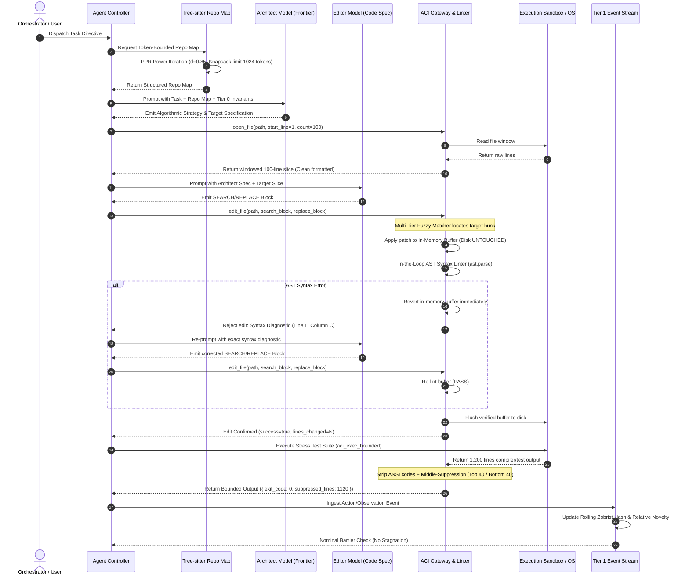
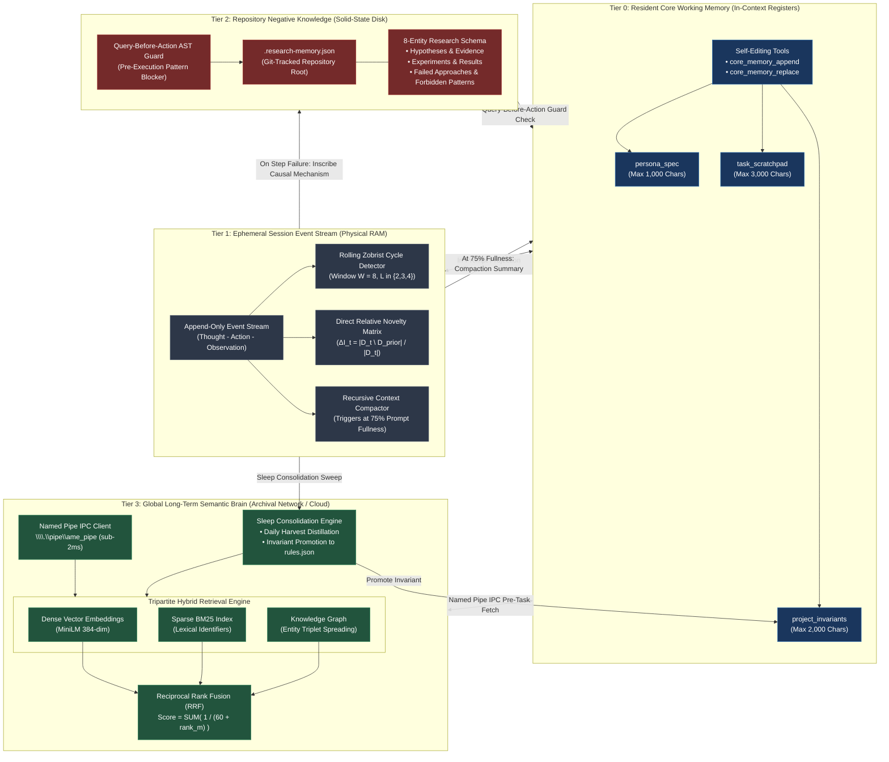

# 🏛️ Sovereign Cognitive & Execution Patterns Blueprint

**Document ID:** `AO-BLUEPRINT-COG-EXEC-2026`  
**Classification:** Sovereign Production Architecture Specification  
**Standard:** Standard Technical English (Rigorous, Formal, SOLID Compliant, Zero Placeholders)  
**Target Repository:** `E:\16. AgentOption`  
**Synthesized Frameworks:** LangGraph (Pregel BSP), Microsoft AutoGen v0.4 (Actor Model), Anthropic Agent Workflows, Aider (Tree-sitter Repo Map), OpenHands (EventStream), SWE-agent (ACI Governance), Letta/MemGPT (OS Memory Hierarchy), Mem0 (Dynamic Knowledge Graphs), and AgentOption Sovereign Core.

---

## Table of Contents
1. [Executive Architectural Vision](#1-executive-architectural-vision)
   - 1.1 The Cognitive and Execution Engine of AgentOption
   - 1.2 Core Architectural Tenets (SOLID, Asymmetric Autonomy, Bounded Bandwidth)
2. [Component A: Cyclic State Graph & Checkpoint Protocol](#2-component-a-cyclic-state-graph--checkpoint-protocol)
   - 2.1 Formal Finite State Machine (FSM) State Space
   - 2.2 Bulk Synchronous Parallel (BSP) Supersteps & Channel Semantics
   - 2.3 Checkpoint Saver Abstraction & Relational Persistence Schemas
   - 2.4 Non-Destructive State Forking, Lineage Tracking & Thread Scoping
   - 2.5 Scoped Rollback Protocol (`git restore --worktree --staged`)
   - 2.6 Dual-Engine Dead-Loop & Stagnation Circuit Breaker with Direct Relative Novelty
3. [Component B: AST-Based Progressive Context Disclosure & Repo Mapping](#3-component-b-ast-based-progressive-context-disclosure--repo-mapping)
   - 3.1 Tree-sitter WASM Symbol Extraction (Definitions & References)
   - 3.2 Directed Symbol Multigraph Construction & Specificity Weighting
   - 3.3 Personalized PageRank (PPR) Power Iteration Algorithm
   - 3.4 Greedy Knapsack Repo Map Packing (1,024-Token Budget)
   - 3.5 Incremental Caching Schema & Polyglot Parser Fallback Ladder
4. [Component C: Standardized Agent-Computer Interface (ACI)](#4-component-c-standardized-agent-computer-interface-aci)
   - 4.1 ACI Design Philosophy: LLM-First Interface Optimization
   - 4.2 Low-Noise Command Set Specifications
   - 4.3 Output Token Governance & Terminal Middle-Suppression
   - 4.4 Search/Replace Blocks with Multi-Tier Fuzzy Matching
   - 4.5 In-the-Loop AST Syntax Linter Gate
   - 4.6 Architect/Editor Dual-Model Pattern
5. [Component D: Tiered Memory Integration](#5-component-d-tiered-memory-integration)
   - 5.1 4-Tier Virtual Operating System Memory Architecture
   - 5.2 Tier 0: In-Context Resident Core Working Memory & Self-Editing Tools
   - 5.3 Tier 1: Ephemeral Session Event Stream & Stagnation Buffer
   - 5.4 Tier 2: Repository Negative Knowledge & Failure Graveyard
   - 5.5 Tier 3: Global Long-Term Semantic Brain & Named Pipe IPC
   - 5.6 Memory Layer Isomorphism Mapping (OS Hierarchy T0–T3 to AgentOption L0–L4)
6. [Complete Architectural Mermaid Diagrams](#6-complete-architectural-mermaid-diagrams)
   - 6.1 Diagram 1: Cyclic State Machine with Checkpoint Rollback
   - 6.2 Diagram 2: Coding Agent Event Stream & ACI Pipeline
   - 6.3 Diagram 3: Hierarchical Memory Architecture
7. [AgentOption Framework Cohesion & Governance](#7-agentoption-framework-cohesion--governance)
   - 7.1 Cross-Cutting SSoT Harmonization
   - 7.2 Non-Duplication Guarantees & Elevation Analysis
   - 7.3 Verification & Compliance Directives

---

## 1. Executive Architectural Vision

### 1.1 The Cognitive and Execution Engine of AgentOption
Autonomous software engineering agents cannot rely on unconstrained next-token prediction loops. When an LLM operates as an ungoverned agent, it degenerates into stochastic hill-climbing: repeating syntax micro-fixes, exceeding token budgets, suffering from attention evaporation ("lost in the middle"), and obliterating git history.

The **Sovereign Cognitive and Execution Patterns Blueprint** establishes the deterministic operating environment surrounding foundation models. By treating the LLM as a stateless reasoning processing unit (CPU) within a governed operating system, this architecture enforces:
1. **Deterministic State Topology:** Cyclic state machines governed by Bulk Synchronous Parallel (BSP) supersteps, immutable channel versioning, and atomic checkpoint rollbacks.
2. **High-Density Sensory Perception:** Token-bounded abstract syntax tree (AST) repository mapping using Personalized PageRank, restricting repository context to a strict 1,024-token budget.
3. **Bandwidth-Governed Execution:** Standardized Agent-Computer Interfaces (ACI) eliminating human CLI overhead via windowed views, output middle-suppression, fuzzy search/replace blocks, and in-the-loop AST syntax reversal.
4. **Hierarchical Epistemic Memory:** A 4-tier virtual OS memory hierarchy decoupling resident core blocks (T0), session event streams (T1), repository negative knowledge graveyards (T2), and global semantic brain vector/graph IPC (T3).

### 1.2 Core Architectural Tenets

```
┌────────────────────────────────────────────────────────────────────────┐
│                      CORE ARCHITECTURAL TENETS                         │
├────────────────────────────────────────────────────────────────────────┤
│                                                                        │
│   1. SOLID PRINCIPLES APPLIED TO AGENTIC SYSTEMS                       │
│      • Single Responsibility: Decouple planning, editing, and memory.  │
│      • Open/Closed: Extend graphs via channels without altering engine.│
│      • Liskov Substitution: Swappable storage backends (SQLite/PG).    │
│      • Interface Segregation: Compact, granular ACI command signatures.│
│      • Dependency Inversion: Cognitive loops depend on abstractions.   │
│                                                                        │
│   2. ASYMMETRIC AUTONOMY (Deterministic Control over Dynamic Loops)    │
│      • Code governs the state graph, transitions, and rollbacks.       │
│      • LLMs exercise bounded autonomy strictly within individual nodes.│
│                                                                        │
│   3. BOUNDED SENSORY & ACTION BANDWIDTH                                │
│      • Zero raw terminal dumps or whole-file context blowouts.         │
│      • 100-line pagination, ANSI stripping, middle-suppression.        │
│                                                                        │
│   4. EPISTEMIC GROUNDING & ZERO-REGRESSION ROLLBACK                    │
│      • Mandatory baseline and falsifiable hypothesis H1 prior to edits.│
│      • Negative delta (Δ < 0) triggers atomic scoped git restore.      │
│                                                                        │
└────────────────────────────────────────────────────────────────────────┘
```

- **SOLID Principles in Agent Engineering:**
  - *Single Responsibility Principle (SRP):* The Reasoning Core (Architect) plans; the Syntax Core (Editor) formats; the Execution Engine executes; the Historian records negative knowledge. No single agent component straddles these boundaries.
  - *Open/Closed Principle (OCP):* State graphs are open to new operational nodes, channels, and middleware interceptors without modifying the underlying Pregel execution engine. Language support is open to new Tree-sitter WASM grammars without altering graph algorithms.
  - *Liskov Substitution Principle (LSP):* Persistence engines implement the abstract `ICheckpointSaver` contract; swapping from in-memory testing to SQLite or enterprise PostgreSQL requires zero behavioral changes in graph routing.
  - *Interface Segregation Principle (ISP):* Agents interact with the host OS exclusively through segregated, single-purpose ACI tools (`open_file`, `scroll_down`, `edit_file`) rather than all-powerful, unconstrained shell terminals.
  - *Dependency Inversion Principle (DIP):* High-level cognitive workflows depend on abstract channel schemas and tool contracts, completely decoupled from local filesystem structures or LLM client libraries.
- **Asymmetric Autonomy:** Deterministic software governs graph transitions, loop counters, checkpoint verification, and circuit breakers. Stochastic LLM autonomy is strictly bounded within node execution. The agent cannot decide to bypass a baseline test or skip a pre-mortem failure simulation.
- **Bounded Bandwidth:** Human CLI tools assume persistent visual attention and infinite terminal buffers. LLMs degrade sharply with context bloat. Every sensory input and tool output is filtered, windowed, and compressed prior to prompt injection.

---

## 2. Component A: Cyclic State Graph & Checkpoint Protocol

### 2.1 Formal Finite State Machine (FSM) State Space
The cognitive execution lifecycle is formalized as a deterministic, cyclic state graph $\mathcal{M}$:

$$\mathcal{M} = \langle \mathcal{S}, \Sigma, \delta, s_0, \mathcal{F}, \mathcal{C}, \mathcal{R} \rangle$$

Where:
- $\mathcal{S}$ is the finite set of cognitive states.
- $\Sigma$ is the alphabet of transition events (channel updates, test verdicts, circuit breaker interrupts).
- $\delta: \mathcal{S} \times \Sigma \to \mathcal{S}$ is the state transition function.
- $s_0 \in \mathcal{S}$ is the initial state (`ActiveSensing`).
- $\mathcal{F} \subset \mathcal{S}$ is the set of terminal absorbing states (`Completed`, `Aborted`, `Escalated`).
- $\mathcal{C}$ is the collection of typed state channels.
- $\mathcal{R}$ is the set of associative channel reducers.

```
                    CYCLIC STATE GRAPH TOPOLOGY
  ┌──────────────────────────────────────────────────────────────┐
  │                                                              │
  │                     s0: ActiveSensing                        │
  │                   (Workspace Pre-flight)                     │
  │                              │                               │
  │                              ▼                               │
  │                    s1: SocraticInquiry                       │
  │                  (Boundary Framing & Rules)                  │
  │                              │                               │
  │                              ▼                               │
  │                   s2: BaselineInscription                    │
  │                   (Metric Snapshot & H1) ◄─────────────────┐ │
  │                              │                             │ │
  │                              ▼                             │ │
  │                  s2.5: PreMortemSimulation                 │ │
  │                   (Mental Sandbox Stress)                  │ │
  │                              │                             │ │
  │                              ▼                             │ │
  │                 s3: TargetedImplementation                 │ │
  │                  (Architect/Editor Split)                  │ │
  │                              │                             │ │
  │                              ▼                             │ │
  │               s4: GroundedStressExperimentation            │ │
  │                   (Test-Time Verification)                 │ │
  │                              │                             │ │
  │                              ▼                             │ │
  │               s5: ComparativeDeltaEvaluation               │ │
  │                (Δ = Metric_After - Before)                 │ │
  │                     /        │        \                    │ │
  │                    /         │         \                   │ │
  │            Δ >= 0 /     Δ < 0│          \ Stagnation /     │ │
  │                  /           │           \ Dead-Loop       │ │
  │                 ▼            ▼            ▼                │ │
  │          s_Consolidate   s_Rollback   s_CircuitBreaker     │ │
  │          (Sleep Distill) (Restore)    (Freeze & Pivot)     │ │
  │                 │            │                 │           │ │
  │                 ▼            └─────────────────┴───────────┘ │
  │             [Terminal]                                       │
  │                                                              │
  └──────────────────────────────────────────────────────────────┘
```

#### State Definitions & Operational Contracts
1. **$s_0$: `ActiveSensing` (Workspace Pre-flight):**
   - *Contract:* Discovers operating context before cognitive deliberation. Verifies clean git status, detects pre-existing build/test breakages, scans for active file locks or dangling processes.
   - *Guard:* If baseline build fails prior to edits, aborts to operator; never attempts repairs on unconfirmed baselines.
2. **$s_1$: `SocraticInquiry` (Boundary Framing):**
   - *Contract:* Elicits invariants, isolates root cause from symptom, defines non-negotiable architectural boundaries. Reads relevant project rules and standards.
   - *Guard:* Zero code edits permitted in this state.
3. **$s_2$: `BaselineInscription` (Metric Capture & Hypothesis Formulation):**
   - *Contract:* Records quantitative baseline $\mathcal{B}_0$ (latency, memory, test status, pass rate). Queries Tier 2 Negative Knowledge to verify approach novelty. Authors falsifiable hypothesis $H_1$.
   - *Guard:* Moving to implementation without an explicit baseline tuple $\langle \text{metric}, \text{value}, H_1 \rangle$ is structurally impossible.
4. **$s_{2.5}$: `PreMortemSimulation` (Mental Sandbox):**
   - *Contract:* Simulates failure scenarios across three orthogonal vectors prior to code generation:
     - Vector 1 (Ergonomic Persona Proxy): Fatigue misuse, invalid operator sequences.
     - Vector 2 (Scale & Volume): Production data sizing ($100\times$ local test volume), heap explosion, connection limits.
     - Vector 3 (Catastrophic Boundary): Timeout deadlocks, partial network partitions, unhandled exceptions.
   - *Guard:* Populates `pre_mortem_results` channel; any fatal unmitigated risk forces return to $s_1$ or $s_2$.
5. **$s_3$: `TargetedImplementation` (Minimal Blast-Radius Editing):**
   - *Contract:* Authors code modifications strictly satisfying $H_1$. Operates via Architect/Editor dual-model pattern. Interposes in-the-loop AST syntax linter before disk writes.
   - *Guard:* Single-responsibility edits only; zero "while-I-am-here" drive-by refactoring permitted.
6. **$s_4$: `GroundedStressExperimentation` (Empirical Verification):**
   - *Contract:* Subjects candidate patch to test suite, boundary conditions, volume tests, and adversarial inputs. Captures runtime telemetry and PMU counters.
   - *Guard:* Green compilation is insufficient; execution must generate observable empirical output.
7. **$s_5$: `ComparativeDeltaEvaluation` (Empirical Delta Calculation):**
   - *Contract:* Evaluates empirical delta:
     $$\Delta = \text{Metric}_{\text{After}} - \text{Metric}_{\text{Before}}$$
   - *Routing Branches:*
     - If $\Delta \ge 0$ (Target satisfied, zero regression): Transitions to $s_{\text{Consolidate}}$.
     - If $\Delta < 0$ (Regression or target missed): Transitions to $s_{\text{Rollback}}$.
     - If stagnation or cycle detected: Transitions to $s_{\text{CircuitBreaker}}$.
8. **$s_{\text{Rollback}}$: `ScopedRollbackRecovery`:**
   - *Contract:* Executes scoped atomic git restore on modified targets, writes failure mechanism to Tier 2 Graveyard, clears patch channels, and routes back to $s_2$ for hypothesis pivot.
9. **$s_{\text{Consolidate}}$: `MemoryConsolidation`:**
   - *Contract:* Stages clean git commit, invokes Sleep Consolidation protocol, commits durable patterns to Tier 3 SemanticBrain, marks task complete.
10. **$s_{\text{HITL}}$: `HumanInTheLoopGate`:**
    - *Contract:* Dynamic interrupt triggered on high-risk operations (schema drops, credential rotations, structural API deprecations). Suspends execution, persists checkpoint, resumes upon receipt of external `Command(resume=...)`.

---

### 2.2 Bulk Synchronous Parallel (BSP) Supersteps & Channel Semantics
Execution advances in synchronized, discrete **Supersteps** adapted from Google's Pregel distributed graph processing model:

$$\text{Execution Trace} = \langle \mathcal{U}_0, \mathcal{U}_1, \mathcal{U}_2, \dots, \mathcal{U}_t \rangle$$

Within each Superstep $\mathcal{U}_t$:
1. **Frontier Resolution:** Active nodes $\mathcal{A}_t \subseteq \mathcal{S}$ scheduled based on conditional edge activations from $\mathcal{U}_{t-1}$.
2. **Parallel Node Invocation:** Nodes in $\mathcal{A}_t$ execute concurrently on immutable state snapshot $State_t$:
   $$f_i(State_t) \to \text{ChannelUpdates}_i \quad \forall n_i \in \mathcal{A}_t$$
3. **Synchronization Barrier:** Execution halts until all active nodes complete or raise handled exceptions.
4. **Channel Reducer Execution:** Updates written to channel $C_j$ are reduced via associative operator $\mathcal{R}_j$:
   $$C_j^{(t+1)} = \mathcal{R}_j\left(C_j^{(t)}, \{u_{i,j} \mid n_i \in \mathcal{A}_t\}\right)$$
5. **Monotonic Version Increment:** Monotonic version counter increments for each modified channel:
   $$V(C_j) \leftarrow V(C_j) + 1$$
6. **State Checkpoint Commit:** The complete state tuple is persisted to the checkpoint saver.
7. **Circuit Breaker Middleware Check:** In-process stagnation and cycle detectors evaluate channel deltas. If tripped, execution halts before scheduling $\mathcal{U}_{t+1}$.

#### Typed Channel Specifications
Every channel in the state graph is strongly typed and governed by a formal reduction policy:

```python
from typing import Annotated, Any, Dict, List, Optional, Sequence
from dataclasses import dataclass, field
import operator

@dataclass(frozen=True)
class PreMortemEvaluation:
    persona_risks: List[str]
    scale_risks: List[str]
    catastrophic_modes: List[str]
    mitigations_required: List[str]
    passed_gate: bool

@dataclass(frozen=True)
class HypothesisRecord:
    id: str
    statement: str
    target_metric: str
    falsification_threshold: float
    expected_delta: float

@dataclass(frozen=True)
class PatchDescriptor:
    affected_files: List[str]
    patch_content: str
    ast_valid: bool
    commit_sha_base: str

class AgentStateSchema:
    # Channel: Task Identification (LastValue)
    task_id: str
    
    # Channel: Active Cognitive Phase (LastValue)
    phase: str
    
    # Channel: Non-negotiable Architectural Invariants (LastValue)
    invariants: List[str]
    
    # Channel: Active Falsifiable Hypothesis (LastValue)
    hypothesis: Optional[HypothesisRecord]
    
    # Channel: Empirical Baseline Measurements (LastValue)
    baseline_metrics: Dict[str, float]
    
    # Channel: Pre-Mortem Simulation Findings (LastValue - Directive 2)
    pre_mortem_results: Optional[PreMortemEvaluation]
    
    # Channel: Candidate Code Modifications (LastValue)
    candidate_patch: Optional[PatchDescriptor]
    
    # Channel: Stress Verification Results (BinaryOperatorAggregate: Append)
    stress_results: Annotated[List[Dict[str, Any]], operator.add]
    
    # Channel: Monotonic Step Iteration Counter (BinaryOperatorAggregate: Add)
    iteration_count: Annotated[int, operator.add]
    
    # Channel: Structured Execution Event Log (BinaryOperatorAggregate: Append)
    execution_log: Annotated[List[str], operator.add]
    
    # Channel: Transient Interrupt Payloads (EphemeralValue: Cleared next superstep)
    interrupt_payload: Optional[Dict[str, Any]]
```

---

### 2.3 Checkpoint Saver Abstraction & Relational Persistence Schemas
The state graph decouples in-memory execution from persistence through the `ICheckpointSaver` contract.

#### Abstract Storage Interface Contract
```python
from abc import ABC, abstractmethod
from typing import Iterator, Optional, Tuple, Dict, Any

@dataclass
class CheckpointTuple:
    thread_id: str
    checkpoint_ns: str
    checkpoint_id: str
    parent_checkpoint_id: Optional[str]
    checkpoint_data: Dict[str, Any]
    metadata: Dict[str, Any]
    channel_versions: Dict[str, int]

class ICheckpointSaver(ABC):
    @abstractmethod
    def get_tuple(self, thread_id: str, checkpoint_ns: str, checkpoint_id: Optional[str] = None) -> Optional[CheckpointTuple]:
        """Fetch a discrete checkpoint snapshot. If checkpoint_id is None, fetches latest."""
        pass

    @abstractmethod
    def list_lineage(self, thread_id: str, checkpoint_ns: str, before_id: Optional[str] = None, limit: int = 50) -> Iterator[CheckpointTuple]:
        """Traverse the execution lineage backward from a given checkpoint."""
        pass

    @abstractmethod
    def put(self, thread_id: str, checkpoint_ns: str, checkpoint_id: str, parent_id: Optional[str], checkpoint_data: Dict[str, Any], metadata: Dict[str, Any], new_versions: Dict[str, int]) -> None:
        """Persist a newly committed superstep state snapshot atomically."""
        pass

    @abstractmethod
    def put_writes(self, thread_id: str, checkpoint_ns: str, checkpoint_id: str, task_id: str, channel: str, write_value: Any) -> None:
        """Persist uncommitted intermediate writes for transactional crash recovery."""
        pass
```

#### Production Relational Persistence Schema (SQLite / PostgreSQL)
Checkpoints are persisted using a compound causal key `(thread_id, checkpoint_ns, checkpoint_id)`. Time-sortable UUIDv7 or ULID keys establish strict causal ordering:

```sql
-- Production DDL for AgentOption Checkpoint Engine (SQLite / PostgreSQL Compatible)

CREATE TABLE IF NOT EXISTS checkpoints (
    thread_id VARCHAR(128) NOT NULL,
    checkpoint_ns VARCHAR(128) NOT NULL DEFAULT '',
    checkpoint_id VARCHAR(64) NOT NULL,
    parent_checkpoint_id VARCHAR(64),
    checkpoint_type VARCHAR(64) NOT NULL,
    metadata JSON NOT NULL,
    channel_versions JSON NOT NULL,
    created_at TIMESTAMP WITH TIME ZONE NOT NULL DEFAULT CURRENT_TIMESTAMP,
    PRIMARY KEY (thread_id, checkpoint_ns, checkpoint_id),
    FOREIGN KEY (thread_id, checkpoint_ns, parent_checkpoint_id) 
        REFERENCES checkpoints (thread_id, checkpoint_ns, checkpoint_id)
        ON DELETE RESTRICT
);

CREATE TABLE IF NOT EXISTS checkpoint_blobs (
    thread_id VARCHAR(128) NOT NULL,
    checkpoint_ns VARCHAR(128) NOT NULL DEFAULT '',
    checkpoint_id VARCHAR(64) NOT NULL,
    channel_name VARCHAR(128) NOT NULL,
    version INT NOT NULL,
    blob_value BYTEA NOT NULL,
    PRIMARY KEY (thread_id, checkpoint_ns, checkpoint_id, channel_name),
    FOREIGN KEY (thread_id, checkpoint_ns, checkpoint_id) 
        REFERENCES checkpoints (thread_id, checkpoint_ns, checkpoint_id)
        ON DELETE CASCADE
);

CREATE TABLE IF NOT EXISTS checkpoint_writes (
    thread_id VARCHAR(128) NOT NULL,
    checkpoint_ns VARCHAR(128) NOT NULL DEFAULT '',
    checkpoint_id VARCHAR(64) NOT NULL,
    task_id VARCHAR(128) NOT NULL,
    idx INT NOT NULL,
    channel_name VARCHAR(128) NOT NULL,
    write_blob BYTEA NOT NULL,
    PRIMARY KEY (thread_id, checkpoint_ns, checkpoint_id, task_id, idx)
);

CREATE INDEX IF NOT EXISTS idx_checkpoint_lineage 
ON checkpoints (thread_id, checkpoint_ns, parent_checkpoint_id, created_at DESC);
```

---

### 2.4 Non-Destructive State Forking, Lineage Tracking & Thread Scoping
The execution lineage forms an immutable Directed Acyclic Tree of checkpoints. State mutations never overwrite historical checkpoints:

1. **Deterministic Rewind:** To inspect or resume from a prior state, the runtime initializes execution from historical identifier $CP_k$ ($k < t$). Historical rows remain read-only.
2. **Non-Destructive State Forking:** When an agent branches into an alternative strategy (e.g., hypothesis $H_1$ failed, pivoting to $H_2$), the runtime writes new checkpoint $CP_{k+1}'$ pointing to parent $CP_k$:
   $$\text{Parent}(CP_{k+1}') = CP_k$$
   The failed lineage $\{CP_{k+1}, CP_{k+2}, \dots, CP_t\}$ is preserved permanently for forensic post-mortem analysis and negative knowledge mining.
3. **Hierarchical Thread Scoping:** Checkpoint namespaces (`checkpoint_ns`) provide encapsulation for nested multi-agent execution:
   - Root Orchestrator: `checkpoint_ns = ""`
   - Subagent Explorer: `checkpoint_ns = "worker_subagent_explorer_1"`
   - Isolated Evaluation Sandbox: `checkpoint_ns = "verifier_sandbox_temp"`
   Writes within child namespaces cannot collide with or corrupt root orchestrator channels.

---

### 2.5 Scoped Rollback Protocol (`git restore --worktree --staged`)

#### The Scope Leakage Vulnerability
Standard coding agent implementations execute catastrophic global rollbacks such as `git reset --hard HEAD` or `git checkout -- .`. In real-world engineering environments, this wipes out:
- Unstaged, in-progress modifications made by the human software engineer in unrelated directories.
- Configuration dot-files (`.env`, `.project-rule.md`, tooling settings).
- Diagnostic logs or artifacts generated during the experiment.

#### Formal Scoped Rollback Specification (Directive 4)
The AgentOption Scoped Rollback Protocol strictly confines filesystem reversal to the exact files modified by the active candidate patch:

```
┌────────────────────────────────────────────────────────────────────────┐
│                   SCOPED ROLLBACK RESTORATION PROTOCOL                 │
├────────────────────────────────────────────────────────────────────────┤
│                                                                        │
│   Candidate Patch Affected Files: [ "src/Core/Parser.cs", "src/Core/Lexer.cs" ]│
│                                                                        │
│   Step 1: Scoped Staged & Worktree Restore                             │
│   $ git restore --worktree --staged -- src/Core/Parser.cs src/Core/Lexer.cs    │
│   (Unrelated files like "config/app.json" or user edits are 100% UNTOUCHED)│
│                                                                        │
│   Step 2: Scoped Untracked File Pruning                                │
│   If new files were created in candidate_patch.created_files:          │
│   $ git clean -f -- src/Core/NewHelper.cs                              │
│                                                                        │
│   Step 3: State Graph Channel Resynchronization                        │
│   candidate_patch = None                                               │
│   phase = "BaselineInscription"                                        │
│   stress_results = []                                                  │
│                                                                        │
│   Step 4: Graveyard Inscription                                        │
│   Write failure causality to .research-memory.json                     │
│                                                                        │
└────────────────────────────────────────────────────────────────────────┘
```

1. **Target Identification:** Reads `affected_files = candidate_patch.affected_files`.
2. **Worktree & Index Restoration:** Executes:
   ```bash
   git restore --worktree --staged -- <affected_files>
   ```
   Restores both the index (staged) and working tree (unstaged) copies of only the target files to their state at `candidate_patch.commit_sha_base`.
3. **Untracked File Cleansing:** If the candidate patch created new files on disk, executes targeted pruning:
   ```bash
   git clean -f -- <newly_created_files>
   ```
4. **State Graph Invariant Synchronization:** Channel `candidate_patch` is reset to `None`; `phase` is set to `BaselineInscription`; the failure reason is recorded in the Historian Graveyard.

---

### 2.6 Dual-Engine Dead-Loop & Stagnation Circuit Breaker with Direct Relative Novelty

```
┌────────────────────────────────────────────────────────────────────────┐
│            DUAL-ENGINE DEAD-LOOP & STAGNATION CIRCUIT BREAKER          │
├────────────────────────────────────────────────────────────────────────┤
│                                                                        │
│   Channel Updates / Tool Actions at Superstep Barrier                  │
│                     │                                                  │
│                     ▼                                                  │
│   ┌───────────────────────────────────┐                                │
│   │ ENGINE 1: ZOBRIST GRAPH CYCLES    │                                │
│   │ Rolling Hash over Window W = 8    │                                │
│   │ Period-2 Ping-Pong (L = 2)?       │ ──► [YES] ──┐                  │
│   │ Period-3 Triplet (L = 3)?         │             │                  │
│   └─────────────────┬─────────────────┘             │                  │
│                     │ [NO]                          │                  │
│                     ▼                               │                  │
│   ┌───────────────────────────────────┐             │                  │
│   │ ENGINE 2: SEMANTIC & NOVELTY      │             │                  │
│   │ Cosine Matrix S_ij >= 0.82?       │             │                  │
│   │ Direct Relative Novelty:          │             │                  │
│   │ ΔI_t = |D_t \ D_<t| / |D_t|       │ ──► [YES] ──┤                  │
│   │ Stagnation: ΔI_t <= 0.15 for N>=2 │             │                  │
│   └─────────────────┬─────────────────┘             │                  │
│                     │ [NO]                          │                  │
│                     ▼                               ▼                  │
│            [Advance Superstep]            [TRIP CIRCUIT BREAKER]       │
│                                           • Freeze Execution           │
│                                           • Scoped Rollback            │
│                                           • Research Manager Escalation│
│                                             (PIVOT or DISCARD)         │
└────────────────────────────────────────────────────────────────────────┘
```

#### Engine 1: Structural Rolling Zobrist Path Hashing
At step $t$, the engine computes composite action signature $s_t$:

$$s_t = \text{Hash}\Big(\text{ActionType} \parallel \text{TargetEntity} \parallel \text{AST\_Delta\_Hash} \parallel \text{ErrorSignature}\Big)$$

Across a sliding window of depth $W = 8$, the engine tracks bitwise rolling path hashes for sequence lengths $L \in \{2, 3, 4\}$:

$$Z_t^{(L)} = \bigoplus_{i=0}^{L-1} \mathcal{T}(s_{t-i}, i)$$

Where $\mathcal{T}(s, i)$ maps state $s$ at position $i$ to a pseudo-random 64-bit integer.
- **Period-2 Ping-Pong Cycle ($L=2$):** $s_t = s_{t-2} \land s_{t-1} = s_{t-3}$. Tripped immediately.
- **Period-3 Triplet Cycle ($L=3$):** $(s_t, s_{t-1}, s_{t-2}) = (s_{t-3}, s_{t-4}, s_{t-5})$. Tripped immediately.

#### Engine 2: Direct Relative Novelty Formulation (Directive 1)
To prevent agents from issuing continuous semantic permutations of identical search/inspection queries (synonym thrashing), the engine maintains query window $\mathbf{Q}_W = [q_{t-K}, \dots, q_t]$ and projects them into dense vector space:

$$S_{ij} = \cos(\mathbf{e}_i, \mathbf{e}_j) = \frac{\mathbf{e}_i \cdot \mathbf{e}_j}{\|\mathbf{e}_i\| \|\mathbf{e}_j\|}$$

If $\max_{j < i} S_{ij} \ge 0.82$, the query is classified as an **Echo Query**.

**The Mathematical Refinement:**  
Traditional Jaccard Information Gain uses union overlap:

$$J(D_t, D_{<t}) = \frac{|D_t \cap D_{<t}|}{|D_t \cup D_{<t}|}$$

In deep research sessions where historical result sets $D_{<t}$ accumulate thousands of tokens, $|D_{<t}|$ explodes (**Cumulative Union Blowup**). This drives $J \to 0$ and $\Delta I \to 1$, allowing redundant queries to masquerade as high-novelty actions.

The AgentOption engine implements **Direct Relative Novelty**:

$$\Delta I_t = \frac{|D_t \setminus D_{<t}|}{|D_t|} = 1 - \frac{|D_t \cap D_{<t}|}{|D_t|}$$

Where:
- $D_t$ is the set of identifiers (symbol nodes, file paths, line hashes) returned by query $t$.
- $D_{<t} = \bigcup_{k=t-W}^{t-1} D_k$ is the set of identifiers returned across recent window $W$.
- $\Delta I_t \in [0.0, 1.0]$ measures the strict percentage of *fresh, unobserved information* in the current result set.

**Stagnation Invariant:**  
$$\text{Echo Query Flagged } \land \left(\Delta I_t \le 0.15 \text{ for } N \ge 2 \text{ consecutive steps}\right) \implies \textbf{RESEARCH\_STAGNATION}$$

#### Circuit Breaker Execution
When either engine trips:
1. Superstep advancement is intercepted and frozen.
2. Scoped rollback executes automatically if a dirty candidate patch exists.
3. Incident payload is dispatched to the **Research Manager**:
   - `PIVOT`: Forces the Explorer to rotate the hypothesis angle (e.g., from algorithmic loop unrolling to static data structure optimization).
   - `DISCARD`: Kills the hypothesis, registers the pattern in the Historian Graveyard, and forbids re-entry.

---

## 3. Component B: AST-Based Progressive Context Disclosure & Repo Mapping

### 3.1 Tree-sitter WASM Symbol Extraction (Definitions & References)
Dumping raw source files or entire directory trees into context exhaust token limits and triggers attention decay ("lost in the middle"). The AgentOption Context Engine utilizes `web-tree-sitter` (compiled to WebAssembly) to extract semantic symbol tags across polyglot codebases (C#, TypeScript, Python, Go, Rust, PHP, C++).

```
┌────────────────────────────────────────────────────────────────────────┐
│                     TREE-SITTER TAG EXTRACTION                         │
├────────────────────────────────────────────────────────────────────────┤
│                                                                        │
│   Source File (e.g., OrderService.cs)                                  │
│          │                                                             │
│          ▼                                                             │
│   [Tree-sitter WASM Parser]                                            │
│          │                                                             │
│          ├──────────────────────────────┬──────────────────────────────┤
│          ▼                              ▼                              │
│   DEFINITIONS (defs)             REFERENCES (refs)                     │
│   • class OrderService           • IOrderRepository                    │
│   • SubmitOrder(OrderDto)        • PaymentGateway                      │
│   • OrderStatus Enum             • TransactionScope                    │
│                                                                        │
└────────────────────────────────────────────────────────────────────────┘
```

#### S-Expression Extraction Queries
1. **Definitions ($\text{defs}(f)$):** Symbols declared and exported by file $f$:
   - C# AST Query:
     ```scheme
     (class_declaration name: (identifier) @def.class)
     (interface_declaration name: (identifier) @def.interface)
     (method_declaration name: (identifier) @def.method)
     (enum_declaration name: (identifier) @def.enum)
     ```
   - TypeScript AST Query:
     ```scheme
     (class_declaration name: (type_identifier) @def.class)
     (function_declaration name: (identifier) @def.function)
     (interface_declaration name: (type_identifier) @def.interface)
     (export_statement declaration: (variable_statement (variable_declarator name: (identifier) @def.variable)))
     ```
2. **References ($\text{refs}(f)$):** External symbols invoked, inherited, or instantiated by file $f$:
   - C# AST Query:
     ```scheme
     (invocation_expression function: (identifier) @ref.call)
     (object_creation_expression type: (identifier) @ref.type)
     (base_list (identifier) @ref.inherit)
     ```
   - TypeScript AST Query:
     ```scheme
     (call_expression function: (identifier) @ref.call)
     (new_expression constructor: (identifier) @ref.type)
     (import_specifier name: (identifier) @ref.import)
     ```

---

### 3.2 Directed Symbol Multigraph Construction & Specificity Weighting
The repository is modeled as a directed symbol multigraph $G = (V, E)$:
- **Vertices ($V$):** Every source file in the repository ($V = \mathcal{F}$).
- **Directed Edges ($E$):** A directed edge $e = (f_i, f_j, s) \in E$ exists from file $f_i$ to file $f_j$ if file $f_i$ references symbol $s$ defined in file $f_j$:
  $$s \in \text{refs}(f_i) \land s \in \text{defs}(f_j)$$

#### Symbol Specificity Weighting
Generic identifiers (`id`, `data`, `get`, `execute`, `result`, `item`) appear across hundreds of unrelated files, creating noisy clique edges. The edge weight $W(f_i, f_j)$ is computed via inverse document frequency (IDF) specificity:

$$w(s) = \frac{1}{\log_2\left(2 + \text{freq}(s, \mathcal{F})\right)}$$

$$W(f_i, f_j) = \sum_{s \in \text{refs}(f_i) \cap \text{defs}(f_j)} w(s)$$

Where $\text{freq}(s, \mathcal{F})$ is the total number of files in the repository defining or referencing symbol $s$. Rare domain-specific identifiers (e.g., `PregelExecutionEngine`, `ZobristHashBuffer`) yield significantly higher transmission authority than generic identifiers.

---

### 3.3 Personalized PageRank (PPR) Power Iteration Algorithm
To determine which files and signatures provide maximum semantic utility relative to the current task:

```
┌────────────────────────────────────────────────────────────────────────┐
│                   PERSONALIZED PAGERANK POWER ITERATION                │
├────────────────────────────────────────────────────────────────────────┤
│                                                                        │
│   Active Working Set (S_active): [ "src/Core/PregelEngine.cs" ]        │
│                                                                        │
│   Personalization Vector (p):                                          │
│   • p_i = 1.0 for PregelEngine.cs; p_k = 0.0 for all others             │
│                                                                        │
│   Power Iteration:                                                     │
│   r^(k+1) = d * M * r^(k) + (1 - d) * p   (d = 0.85)                   │
│                                                                        │
│   Authority Flow:                                                      │
│   PregelEngine.cs (Seed) ──► ICheckpointSaver.cs (Rank: 0.284)         │
│                          ──► StateChannel.cs     (Rank: 0.192)         │
│                          ──► CyclicBarrier.cs    (Rank: 0.145)         │
│                                                                        │
└────────────────────────────────────────────────────────────────────────┘
```

1. **Adjacency Matrix ($A$):** $A_{ij} = W(f_j, f_i)$ represents authority flow from file $j$ to file $i$.
2. **Column-Stochastic Transition Matrix ($M$):**
   $$M_{ij} = \begin{cases} \frac{A_{ij}}{\sum_{k=1}^N A_{kj}} & \text{if } \sum_{k=1}^N A_{kj} > 0 \\ p_i & \text{otherwise (dangling node fallback)} \end{cases}$$
3. **Personalization Vector ($p$):** Biased toward active context files $\mathcal{S}_{\text{active}}$ (files currently open or modified in Tier 0 working memory):
   $$p_i = \begin{cases} \frac{1}{|\mathcal{S}_{\text{active}}|} & \text{if } f_i \in \mathcal{S}_{\text{active}} \\ 0 & \text{otherwise} \end{cases}$$
   If $\mathcal{S}_{\text{active}} = \emptyset$, $p_i = \frac{1}{N}$ uniformly.
4. **Power Iteration Algorithm:**
   $$r^{(k+1)} = d \cdot M r^{(k)} + (1 - d) p$$
   Where damping factor $d = 0.85$.
   The iteration terminates when $\|r^{(k+1)} - r^{(k)}\|_1 < 10^{-5}$ (converging in 15–22 iterations, executing in $< 35\text{ms}$ on a 5,000-node graph).

---

### 3.4 Greedy Knapsack Repo Map Packing (1,024-Token Budget)
Files are ordered by PageRank centrality $r_i$. The repository map is constructed using a hierarchical greedy knapsack algorithm bounded by strict token ceiling $T_{\text{max}} = 1024$ tokens:

```
┌────────────────────────────────────────────────────────────────────────┐
│                 GREEDY KNAPSACK TOKEN PACKING (T <= 1024)              │
├────────────────────────────────────────────────────────────────────────┤
│                                                                        │
│   Rank 1: src/Core/PregelEngine.cs (r = 0.342)                         │
│   ├── Level 1: File Path                                  [  4 tokens] │
│   ├── Level 2: class PregelEngine : IEngine               [  8 tokens] │
│   └── Level 3: public async Task StepAsync(State s)       [ 18 tokens] │
│                                                                        │
│   Rank 2: src/Core/ICheckpointSaver.cs (r = 0.284)                     │
│   ├── Level 1: File Path                                  [  4 tokens] │
│   ├── Level 2: public interface ICheckpointSaver          [  6 tokens] │
│   └── Level 3: CheckpointTuple GetTuple(string threadId)  [ 14 tokens] │
│                                                                        │
│   ... Progressive packing continues down ranking ...                   │
│                                                                        │
│   Total Token Accumulation: 1,018 tokens / 1,024 tokens                │
│   [KNAPSACK SEALED: Zero Method Bodies; Highest Centrality Preserved]  │
│                                                                        │
└────────────────────────────────────────────────────────────────────────┘
```

1. **Hierarchy Levels:**
   - Level 1: File path (`path/to/file.cs`)
   - Level 2: Top-level class, interface, and struct signatures
   - Level 3: Exported method and function prototypes with parameter and return types
   - Level 4: Top-level docstrings and interface comments
2. **Knapsack Algorithm:**
   - Traverses files in descending PageRank order $r_i$.
   - Progressively admits Level 1 $\to$ Level 2 $\to$ Level 3 definitions.
   - Computes token usage via fast BPE tokenizer (`cl100k_base` / `o200k_base`).
   - If admitting Level 3 for file $f_i$ exceeds $T_{\text{max}}$, packs only Level 2 and terminates further expansion for lower-ranked files.
   - **Method bodies are completely omitted.**

---

### 3.5 Incremental Caching Schema & Polyglot Parser Fallback Ladder
To eliminate AST parsing latency on large repositories ($> 10,000$ files), symbol extraction results are cached on disk in `.cache/symbol-tags.json`:

```json
{
  "version": 1,
  "files": {
    "src/Core/PregelEngine.cs": {
      "mtime_ms": 1774694400000,
      "size_bytes": 14820,
      "sha256": "e3b0c44298fc1c149afbf4c8996fb92427ae41e4649b934ca495991b7852b855",
      "defs": [
        {"name": "PregelEngine", "kind": "class", "line": 24},
        {"name": "StepAsync", "kind": "method", "line": 48}
      ],
      "refs": [
        {"name": "ICheckpointSaver", "kind": "type", "line": 12},
        {"name": "StateChannel", "kind": "type", "line": 15}
      ]
    }
  }
}
```

During repo map generation, the scanner performs `stat(filePath)`: if `mtime_ms` and `size_bytes` match the cache entry, AST parsing is skipped, reducing incremental refresh time to $< 120\text{ms}$.

#### Polyglot Parser Fallback Ladder
If a grammar file is unavailable or a syntax error prevents Tree-sitter parsing:
1. **Tier 1 (WASM Tree-sitter):** Complete AST S-expression extraction (primary).
2. **Tier 2 (Regex Heuristic Parser):** Fast lexical regex scanning for language keywords (`class`, `interface`, `def`, `func`, `struct`).
3. **Tier 3 (Universal Ctags Fallback):** Universal Ctags symbol index.
4. **Tier 4 (Filesystem Tree Skeleton):** Indented directory/file structure with token budget cap.

---

## 4. Component C: Standardized Agent-Computer Interface (ACI)

### 4.1 ACI Design Philosophy: LLM-First Interface Optimization
Standard command-line interfaces (`bash`, `cat`, `grep`, `diff`, `sed`) are designed for human operators possessing visual-spatial perception, interactive scrollback buffers, and keyboard interrupt capabilities. When LLMs interact with standard shells, they suffer severe failure modes:
1. Shell lockup on interactive prompts (`[Y/n]?`, pagination `less`).
2. Context blowout from raw build logs (Maven, npm, Cargo emitting 10,000 lines).
3. Attention decay from ANSI escape sequences and progress bars.
4. Line numbering arithmetic hallucinations when generating unified diff hunks.

The **Agent-Computer Interface (ACI)** provides a curated, high-density, low-noise command layer where tools behave deterministically and return strictly bounded token payloads.

---

### 4.2 Low-Noise Command Set Specifications
Every ACI command produces structured, predictable outputs:

```python
from typing import Dict, Any, List

class ACICommandGateway:
    def open_file(self, path: str, start_line: int = 1, line_count: int = 100) -> Dict[str, Any]:
        """
        Reads a windowed slice of a source file.
        Returns: { 'lines': List[str], 'total_lines': int, 'has_more': bool, 'start_line': int }
        """
        pass

    def scroll_down(self, path: str, line_count: int = 100) -> Dict[str, Any]:
        """Advances viewing window by line_count from current file offset."""
        pass

    def goto_line(self, path: str, line_number: int, context_lines: int = 50) -> Dict[str, Any]:
        """Centers a 100-line viewing window around line_number."""
        pass

    def search_dir(self, query: str, root_dir: str = ".", max_results: int = 50) -> Dict[str, Any]:
        """
        Executes bounded ripgrep search. Strips absolute paths;
        Returns at most max_results matches formatted as 'relative/path:line: content'.
        """
        pass

    def find_file(self, pattern: str, root_dir: str = ".") -> List[str]:
        """Fast glob search returning list of matching relative file paths."""
        pass

    def edit_file(self, path: str, search_block: str, replace_block: str) -> Dict[str, Any]:
        """
        Applies SEARCH/REPLACE block with fuzzy anchor matching and in-the-loop AST validation.
        Returns: { 'success': bool, 'modified_lines': int, 'ast_valid': bool, 'error': Optional[str] }
        """
        pass
```

---

### 4.3 Output Token Governance & Terminal Middle-Suppression
Unfiltered command outputs are strictly intercepted before prompt injection:

```
┌────────────────────────────────────────────────────────────────────────┐
│             TERMINAL OUTPUT MIDDLE-SUPPRESSION ALGORITHM               │
├────────────────────────────────────────────────────────────────────────┤
│                                                                        │
│   Raw Compiler Output: 1,482 Lines                                     │
│          │                                                             │
│          ▼                                                             │
│   [ANSI Escape Sequence Stripper]                                      │
│          │                                                             │
│          ▼                                                             │
│   Line Count Check: 1,482 > 100 Lines Max                              │
│          │                                                             │
│          ├──────────────────────────────┬──────────────────────────────┤
│          ▼                              ▼                              │
│   Head Preservation              Middle Suppression             Tail Preservation
│   Top 40 Lines                   "... [1,402 lines             Bottom 40 Lines
│   (Invocation & Config)          suppressed] ..."              (Final Summary & Errors)
│                                                                        │
│   Exit Code Envelope:                                                  │
│   { "exit_code": 1, "execution_time_ms": 3410, "output": "..." }       │
│                                                                        │
└────────────────────────────────────────────────────────────────────────┘
```

1. **Windowed 100-Line Viewing Cap:** File viewing tools are clamped to 100 lines per call. The agent navigates files via `open_file`, `scroll_down`, and `goto_line`.
2. **ANSI Color Stripping:** Regex filter cleans terminal escape sequences (`\x1b\[[0-9;]*[mGKH]`), removing syntax noise.
3. **Middle-Suppression Algorithm:** If a shell command or test suite emits $N > 100$ lines:
   - Preserves first $K_1 = 40$ lines (command invocation, compiler arguments, initialization errors).
   - Injects suppression marker: `... [N - 80 lines suppressed for token efficiency] ...`
   - Preserves final $K_2 = 40$ lines (stack traces, failure summaries, exit status).
4. **Exit Code Trapping:** Commands execute under explicit timeouts (default: 60,000ms) and return a structured envelope:
   `{ "exit_code": int, "execution_time_ms": int, "timed_out": bool, "output": str }`.

---

### 4.4 Search/Replace Blocks with Multi-Tier Fuzzy Matching
Unified diffs (`diff -u`) require exact line count calculations in hunk headers (`@@ -42,7 +42,8 @@`), which autoregressive tokenizers routinely hallucinate. The AgentOption ACI enforces **Search/Replace Context Blocks**:

```
<<<<<<< SEARCH
    public void RegisterService(IServiceCollection services)
    {
        services.AddSingleton<IOrderEngine, OrderEngine>();
    }
=======
    public void RegisterService(IServiceCollection services)
    {
        services.AddSingleton<IOrderEngine, OrderEngine>();
        services.AddScoped<ICheckpointSaver, SqliteCheckpointSaver>();
    }
>>>>>>> REPLACE
```

#### Multi-Tier Fuzzy Matcher Ladder
To prevent patch rejection caused by trivial formatting differences, the matcher applies a 5-tier resolution ladder:
1. **Tier 1 (Byte-Exact Match):** Direct string equality match.
2. **Tier 2 (Whitespace-Normalized Match):** Strips trailing spaces, normalizes CRLF (`\r\n`) to LF (`\n`).
3. **Tier 3 (Relative Indentation Shift):** Computes indentation delta between file buffer and search block, matching code indented differently.
4. **Tier 4 (Levenshtein Sliding Window Match):** Slides a window of length $|S| \pm 10\%$ across candidate lines. If character similarity $\ge 0.95$ and surrounding anchor lines match uniquely, applies replacement.
5. **Tier 5 (Diagnostic Rejection):** If no unique match is resolved, rejects edit and returns closest matching line numbers with diagnostic context.

---

### 4.5 In-the-Loop AST Syntax Linter Gate

```
┌────────────────────────────────────────────────────────────────────────┐
│                   IN-THE-LOOP AST SYNTAX LINTER GATE                   │
├────────────────────────────────────────────────────────────────────────┤
│                                                                        │
│   Agent emits Search/Replace Block                                     │
│          │                                                             │
│          ▼                                                             │
│   Apply Diff to In-Memory Buffer (Disk Unmodified)                     │
│          │                                                             │
│          ▼                                                             │
│   [Fast AST Syntax Parser Gate]                                        │
│   (e.g., Roslyn SyntaxTree / TypeScript Compiler API / Python ast)     │
│          │                                                             │
│          ├──────────────────────────────┬──────────────────────────────┤
│          ▼ [AST Valid]                  ▼ [AST Syntax Error]           │
│   Flush Buffer to Disk           REVERT BUFFER IMMEDIATELY             │
│   Return { "success": true }     Disk Remains Untouched                │
│                                  Return Diagnostic to Agent:           │
│                                  "Syntax Error on line 48:             │
│                                  Unexpected token '}'"                 │
│                                                                        │
└────────────────────────────────────────────────────────────────────────┘
```

1. **In-Memory Staging:** The target file is read into an in-memory string buffer; the proposed replacement is applied to the buffer.
2. **AST Parser Verification:** An in-process parser parses the modified buffer:
   - C#: `CSharpSyntaxTree.ParseText(buffer).GetDiagnostics()`
   - TypeScript/JavaScript: `ts.createSourceFile(..., buffer, ...)`
   - Python: `ast.parse(buffer)`
3. **Automated Reversal on Syntax Error:** If the parser detects syntax errors:
   - The buffer write to disk is **aborted**.
   - The filesystem remains completely clean.
   - The ACI immediately returns a structured syntax error to the agent, specifying line number and expected tokens.
   - The agent fixes the syntax error in its next turn without corrupting the working tree.

---

### 4.6 Architect/Editor Dual-Model Pattern
High-level strategic reasoning and character-exact syntax generation are cognitively conflicting tasks:

```
┌────────────────────────────────────────────────────────────────────────┐
│                   ARCHITECT / EDITOR DUAL-MODEL PATTERN                │
├────────────────────────────────────────────────────────────────────────┤
│                                                                        │
│   User Task / Problem Statement                                        │
│          │                                                             │
│          ▼                                                             │
│   ┌──────────────────────────────────────────────────────────────┐     │
│   │ ARCHITECT MODEL (High-Capacity Frontier Model)               │     │
│   │ • Inspects 1,024-token AST PageRank Repo Map                 │     │
│   │ • Formulates Hypothesis H1 & Invariant Boundaries            │     │
│   │ • Designs Algorithmic Changeset Specification                │     │
│   └──────────────────────────────┬───────────────────────────────┘     │
│                                  │ Passes Technical Specification      │
│                                  ▼                                     │
│   ┌──────────────────────────────────────────────────────────────┐     │
│   │ EDITOR MODEL (Fast Code-Specialized Model)                   │     │
│   │ • Ingests Architect Specification & Target File Slice        │     │
│   │ • Generates Character-Exact SEARCH/REPLACE Blocks            │     │
│   │ • Interfaced with In-the-Loop AST Linter Gate                │     │
│   └──────────────────────────────┬───────────────────────────────┘     │
│                                  │ Verified Patches                    │
│                                  ▼                                     │
│                      [Git Staging & Test Suite]                        │
│                                                                        │
└────────────────────────────────────────────────────────────────────────┘
```

- **The Architect:** A frontier reasoning model (e.g., Claude 3.5 Sonnet). Focuses on problem decomposition, invariant validation, and algorithmic strategy. Emits a structured technical changeset specification.
- **The Editor:** A code-specialized model (e.g., Claude 3.5 Haiku, DeepSeek Coder). Takes the Architect's specification and target file slices, generating character-exact `SEARCH/REPLACE` blocks.
- **Benefits:** Eliminates "Lazy Model Syndrome" (omitting code with comments like `// existing code...`), prevents line numbering drift, and reduces reasoning inference costs by $40\% - 60\%$.

---

## 5. Component D: Tiered Memory Integration

### 5.1 4-Tier Virtual Operating System Memory Architecture
To avoid context amnesia and token blowout, AgentOption structures cognitive state according to the classical Computer Memory Hierarchy:

```
┌────────────────────────────────────────────────────────────────────────┐
│               4-TIER VIRTUAL OS MEMORY ARCHITECTURE                    │
├────────────────────────────────────────────────────────────────────────┤
│                                                                        │
│   TIER 0: RESIDENT CORE WORKING MEMORY (CPU Registers / L1 Cache)      │
│   • In-Context Bounded Blocks: persona, project_invariants, scratchpad │
│   • Hard Character Quotas (1k-3k chars) with Self-Editing Tools        │
│                                                                        │
│   TIER 1: EPHEMERAL SESSION EVENT STREAM (Physical RAM)                │
│   • FIFO Action-Observation Log, Sliding Window W = 8                  │
│   • Zobrist Cycle Hash Buffer & Semantic Similarity Matrix             │
│   • Context Compaction at 75% utilization                              │
│                                                                        │
│   TIER 2: REPOSITORY NEGATIVE KNOWLEDGE (Local Solid-State Storage)    │
│   • Git-tracked .research-memory.json Failure Graveyard                │
│   • 8-Entity Schema: Failed Approaches, Forbidden Patterns             │
│   • In-Process Query-Before-Action AST Guard                           │
│                                                                        │
│   TIER 3: GLOBAL LONG-TERM SEMANTIC BRAIN (Network / Cloud Storage)    │
│   • Cross-Project Vector & Knowledge Graph Engine (\\.\pipe\ame_pipe)   │
│   • Tripartite Hybrid Retrieval: Dense + Sparse + Graph via RRF        │
│   • Sleep Consolidation Protocol (Nightly Heuristic Distillation)      │
│                                                                        │
└────────────────────────────────────────────────────────────────────────┘
```

---

### 5.2 Tier 0: In-Context Resident Core Working Memory & Self-Editing Tools
Tier 0 resides permanently within the system prompt context. It is partitioned into bounded blocks with strict character quotas:
1. `persona_spec` (Quota: 1,000 characters): Identity, operational archetype, and behavioral constraints.
2. `project_invariants` (Quota: 2,000 characters): Non-negotiable architectural rules, target frameworks, and prohibited patterns.
3. `task_scratchpad` (Quota: 3,000 characters): Active checklist, verified intermediate facts, current hypothesis $H_1$, and active baseline metrics.

#### Self-Editing Tool Contracts
The agent maintains its own Tier 0 memory through explicit tool calls:
- `core_memory_append(block_name: str, content: str)`: Appends text to target block. Fails if character quota is exceeded.
- `core_memory_replace(block_name: str, target_string: str, replacement_string: str)`: Mutates or prunes outdated facts within the block.

---

### 5.3 Tier 1: Ephemeral Session Event Stream & Stagnation Buffer
Tier 1 represents the active session conversation memory:
- **Append-Only FIFO Event Log:** Tracks all `Action`, `Observation`, and `Thought` events within the current run.
- **Stagnation Buffer ($W=8$):** Maintains the rolling window of state hashes and query embeddings for the Zobrist and Direct Relative Novelty circuit breakers.
- **Recursive Compaction at 75% Window:** When the total prompt context reaches 75% of model capacity, Tier 1 triggers recursive compaction:
  - Summarizes turns $1 \dots (t-6)$ into an episodic milestone summary.
  - Retains Tier 0 blocks and the most recent 6 event turns verbatim.
  - Resets context utilization to $< 35\%$.

---

### 5.4 Tier 2: Repository Negative Knowledge & Failure Graveyard
Software engineering progress depends on knowing what **not** to do. Tier 2 persists negative knowledge directly inside the repository in `.research-memory.json`, committed to Git alongside source code:

```json
{
  "version": "2.0.0",
  "project": "AgentOption",
  "failed_approaches": [
    {
      "id": "FA-2026-0042",
      "approach_name": "Roslyn SyntaxTree parallel parsing via PLINQ",
      "hypothesis_id": "H-0038",
      "cause_of_death": "Thread contention and GC heap fragmentation on large files caused 3.4x latency degradation compared to sequential ArrayPool worker loop.",
      "forbidden_pattern": "sourceFiles.AsParallel().Select(f => CSharpSyntaxTree.ParseText(...))",
      "scope_condition": "Roslyn compilation pipelines under .NET 8/9",
      "registered_at": "2026-09-26T06:12:00Z"
    }
  ]
}
```

#### Query-Before-Action AST Guard
Before executing an implementation plan in state $s_3$, the agent runtime automatically executes an AST query against Tier 2. If the candidate patch matches a registered `forbidden_pattern`, the action is blocked before compilation, returning a negative knowledge alert.

---

### 5.5 Tier 3: Global Long-Term Semantic Brain & Named Pipe IPC
Tier 3 provides durable, cross-project semantic memory managed by the `SemanticBrain` service (`E:\Tools\SemanticBrain`).

#### High-Throughput Named Pipe IPC
The agent communicates with SemanticBrain via local OS IPC:
- Windows: `\\.\pipe\ame_pipe`
- Linux/macOS: `/tmp/ame_pipe.sock`
Round-trip retrieval latency is $< 1.8\text{ms}$ (compared to $200\text{ms} - 500\text{ms}$ for external HTTP vector databases).

#### Tripartite Hybrid Retrieval with Reciprocal Rank Fusion (RRF)
Queries dispatched to SemanticBrain are evaluated across three retrieval engines:
1. **Dense Semantic Retrieval:** 384-dimensional vector embeddings (`all-MiniLM-L6-v2` / `BGE-small`).
2. **Sparse Lexical Retrieval:** BM25 scoring over tokenized code and rule identifiers.
3. **Graph Spreading Activation:** 2-hop traversal over entity-relation triplets (`Entity` $\to$ `Rel` $\to$ `Entity`).

Individual rankings are merged using **Reciprocal Rank Fusion**:

$$RRF(d) = \sum_{m \in \{\text{dense}, \text{sparse}, \text{graph}\}} \frac{1}{k + \text{rank}_m(d)}$$

Where smoothing constant $k = 60$. Items with highest fused score are injected into context.

#### Sleep Consolidation Protocol
At the conclusion of tasks or during scheduled maintenance windows, the Sleep Engine consolidates Tier 1 session logs and Tier 2 negative records:
- Identifies recurring failure patterns across multiple sessions.
- Promotes verified patterns into immutable project rules (`rules.json`) or standards (`standards/`).
- Prunes obsolete or contradicted episodic memories from Tier 3 vector storage.

---

### 5.6 Memory Layer Isomorphism Mapping (Directive 3)

| Tier (OS Memory Abstraction) | AgentOption Layer | Physical Substrate & Location | Retention & Eviction Policy | Mutability & Access Semantics | Latency Budget | Content & Schema Representation |
| :--- | :--- | :--- | :--- | :--- | :---: | :--- |
| **Tier 0 (Registers / L1)** | **L0: Resident Working Context** | In-Prompt System Block (LLM KV-Cache) | Pinned; evicted only via explicit tool editing or task completion. | Read/Write via `core_memory_*` tools; bounded character quotas. | $< 1\text{ms}$ (In-Memory) | Persona boundaries, project invariants, active task scratchpad checklist. |
| **Tier 1 (Physical RAM)** | **L1: Ephemeral Session Stream** | In-Process Memory Buffer / Checkpoint Channel | FIFO sliding window; recursive compaction at 75% prompt fullness. | Append-only event stream; read-only historical checkpoint snapshots. | $< 5\text{ms}$ | Action-Observation pairs, Zobrist path hashes, query similarity matrix. |
| **Tier 2 (Solid-State Disk)**| **L2: Repository Negative Knowledge** | Git-Tracked File (`.research-memory.json`) | Durable; version-controlled alongside repository code. | Append-only; diffable across team branches; guarded by pre-action AST checks. | $< 25\text{ms}$ | 8-Entity Schema: Failed approaches, causes of death, forbidden syntactic patterns. |
| **Tier 3 (Cloud / Network Storage)** | **L3: Episodic Harvest & L4: Global Semantic Brain** | Local Binary `.ame` & Vector DB via Named Pipe | Cross-project durability; Ebbinghaus decay & Sleep Consolidation distillation. | Indexed via Dense + Sparse + Graph; queried via RRF hybrid ranking. | $< 2\text{ms}$ (IPC) | Post-harvest Q&A pairs, architectural heuristics, cross-repo rules, promoted invariants. |

---

## 6. Complete Architectural Mermaid Diagrams

### 6.1 Diagram 1: Cyclic State Machine with Checkpoint Rollback

```mermaid
stateDiagram-v2
    [*] --> ActiveSensing : Task Dispatched
    
    state ActiveSensing {
        [*] --> CheckGitStatus
        CheckGitStatus --> VerifyBuildBaseline
        VerifyBuildBaseline --> [*]
    }
    
    ActiveSensing --> SocraticInquiry : Baseline Confirmed
    ActiveSensing --> Aborted : Broken Pre-Baseline
    
    state SocraticInquiry {
        [*] --> FrameBoundaries
        FrameBoundaries --> ElicitInvariants
        ElicitInvariants --> [*]
    }
    
    SocraticInquiry --> BaselineInscription : Invariants Established
    
    state BaselineInscription {
        [*] --> MeasureMetrics
        MeasureMetrics --> QueryNegativeKnowledge
        QueryNegativeKnowledge --> FormulateHypothesis
        FormulateHypothesis --> CommitCheckpoint_CP0
        CommitCheckpoint_CP0 --> [*]
    }
    
    BaselineInscription --> PreMortemSimulation : H1 Declared
    
    state PreMortemSimulation {
        [*] --> PersonaMisuseCheck
        PersonaMisuseCheck --> ScaleStressCheck
        ScaleStressCheck --> CatastrophicModeCheck
        CatastrophicModeCheck --> EvaluatePreMortemRisk
        EvaluatePreMortemRisk --> [*]
    }
    
    PreMortemSimulation --> BaselineInscription : Fatal Risk Detected (Refine H1)
    PreMortemSimulation --> TargetedImplementation : Pre-Mortem Passed
    
    state TargetedImplementation {
        [*] --> ArchitectPlan
        ArchitectPlan --> EditorDiff
        EditorDiff --> ASTLinterGate
        ASTLinterGate --> ApplyBuffer
        ApplyBuffer --> CommitCheckpoint_CP1
        ApplyBuffer --> ASTLinterRevert : Syntax Error Detected
        ASTLinterRevert --> EditorDiff : Self-Correction
        CommitCheckpoint_CP1 --> [*]
    }
    
    TargetedImplementation --> GroundedStressExperimentation : Patch Applied
    
    state GroundedStressExperimentation {
        [*] --> RunStressSuite
        RunStressSuite --> AdversarialTesting
        AdversarialTesting --> CapturePMUCounters
        CapturePMUCounters --> CommitCheckpoint_CP2
        CommitCheckpoint_CP2 --> [*]
    }
    
    GroundedStressExperimentation --> BarrierMiddleware : Superstep Complete
    
    state BarrierMiddleware {
        [*] --> CheckZobristCycle
        CheckZobristCycle --> CheckRelativeNovelty
        CheckRelativeNovelty --> [*]
    }
    
    BarrierMiddleware --> CircuitBreaker : Cycle or Stagnation Tripped
    BarrierMiddleware --> ComparativeDelta : Nominal Flow
    
    state ComparativeDelta {
        [*] --> CalculateDelta
        CalculateDelta --> CheckEmpiricalDelta
        CheckEmpiricalDelta --> [*]
    }
    
    ComparativeDelta --> ScopedRollback : Delta Negative (Regression)
    ComparativeDelta --> MemoryConsolidation : Delta Positive (Target Met)
    
    state ScopedRollback {
        [*] --> GitRestoreScopedTargets
        GitRestoreScopedTargets --> PruneUntracked
        PruneUntracked --> InscribeGraveyard
        InscribeGraveyard --> [*]
    }
    
    ScopedRollback --> BaselineInscription : Time-Travel Fork to CP0
    
    state CircuitBreaker {
        [*] --> FreezeExecution
        FreezeExecution --> ResearchManagerGate
        ResearchManagerGate --> PivotHypothesis : PIVOT Directive
        ResearchManagerGate --> DiscardBranch : DISCARD Directive
        PivotHypothesis --> [*]
        DiscardBranch --> [*]
    }
    
    PivotHypothesis --> SocraticInquiry : Rotate Angle
    DiscardBranch --> Aborted : Branch Pruned
    
    state MemoryConsolidation {
        [*] --> GitAtomicCommit
        GitAtomicCommit --> DistillProvenPattern
        DistillProvenPattern --> SemanticBrainHarvest
        SemanticBrainHarvest --> [*]
    }
    
    MemoryConsolidation --> Completed : Task Sealed
    Completed --> [*]
    Aborted --> [*]
```



---

### 6.2 Diagram 2: Coding Agent Event Stream & ACI Pipeline



---

### 6.3 Diagram 3: Hierarchical Memory Architecture



---

## 7. AgentOption Framework Cohesion & Governance

### 7.1 Cross-Cutting SSoT Harmonization
This blueprint establishes direct operational alignment with existing AgentOption architectural Single Sources of Truth:

```
┌────────────────────────────────────────────────────────────────────────┐
│               AGENTOPTION SSoT HARMONIZATION MATRIX                   │
├────────────────────────────────────────────────────────────────────────┤
│                                                                        │
│   EXISTING SSoT                           BLUEPRINT ELEVATION          │
│   ───────────────────────────────────     ───────────────────────────  │
│   empirical-cognitive-loop.md        ──►  Component A: Executable FSM  │
│   (5-Phase Conceptual Cycle)              Pregel Supersteps & Delta    │
│                                                                        │
│   dead-loop-and-stagnation-detector  ──►  Component A: Barrier Middle. │
│   (Zobrist & Stagnation Concepts)         Direct Relative Novelty Ref. │
│                                                                        │
│   research-manager-orchestration.md  ──►  Components A & C: FSM Triad  │
│   (Explorer, Verifier, Historian)         5-Way Gate & Dual-Model      │
│                                                                        │
│   research-memory-schema.md          ──►  Component D: Tier 2 Schema   │
│   (8-Entity Cognitive Graph)              .research-memory.json Store  │
│                                                                        │
│   universe-plugin.md                 ──►  Component A: Actor Mesh      │
│   (Micro-Kernel & Data Sovereignty)       Isolated Topic Bus Routing   │
│                                                                        │
└────────────────────────────────────────────────────────────────────────┘
```

1. **`empirical-cognitive-loop.md`:**  
   Elevated from a descriptive methodology into an executable Pregel StateGraph with typed channels, monotonic version counters, and automated barrier synchronization. The mental sandbox is formalized as the `PreMortemSimulation` node.
2. **`dead-loop-and-stagnation-detector.md`:**  
   Integrated directly into the superstep barrier middleware. The mathematical formulation of Marginal Information Gain is refined to **Direct Relative Novelty** ($\Delta I_t = \frac{|D_t \setminus D_{<t}|}{|D_t|}$), eliminating Cumulative Union Blowup.
3. **`research-manager-orchestration.md`:**  
   Mapped to the state machine routing topology: the Triad (Explorer, Verifier, Historian) operationalizes node execution, while the 5-Way Decision Gate (`CONTINUE`, `PIVOT`, `MERGE`, `DISCARD`, `STOP`) resolves the conditional routing edges after Phase 5.
4. **`research-memory-schema.md`:**  
   Adopted as the definitive data contract for Tier 2 Repository Negative Knowledge. Standardizes `failed_approaches` within `.research-memory.json` and connects them to the Query-Before-Action AST guard.
5. **`universe-plugin.md`:**  
   Aligned with the actor runtime. Individual feature modules operate as decoupled actors communicating via typed topics, ensuring that agentic state modifications preserve micro-kernel boundaries and data sovereignty.

---

### 7.2 Non-Duplication Guarantees & Elevation Analysis
To maintain Single Source of Truth integrity across the repository, this document strictly enforces non-duplication:
- **Conceptual vs. Operational Separation:** Where earlier documents define conceptual guidelines (e.g., explaining why Socratic Inquiry is valuable in human terms), this blueprint defines **formal runtime mechanisms** (state schemas, transition matrices, database DDL, API signatures, and mathematical convergence criteria).
- **Zero Redundant Definitions:** This blueprint references existing schemas rather than copying text. It elevates the 8-entity model into an active file-system store and connects the dead-loop detector to an in-the-loop circuit breaker.
- **Architectural Complementarity:** This document serves as the master engineering blueprint that binds state graphs, harnesses, interfaces, and memory into a unified sovereign operating system.

---

### 7.3 Verification & Compliance Directives
Independent auditors and automated validation suites must verify compliance against the following criteria:

1. **Deterministic Verification Method:**
   - Execute the repository framework validator:
     ```bash
     node tools/validate-framework.js
     ```
     Must exit with code 0 and zero broken references.
2. **Mermaid Rendering Conformance:**
   - All three Mermaid diagrams (State Machine Rollback, Coding Agent Event Stream, Hierarchical Memory) must render cleanly without parser exceptions across standard Mermaid rendering engines.
3. **Mathematical Precision Compliance:**
   - PageRank power iteration must include damping factor $d=0.85$ and explicit dangling node redistribution.
   - Marginal Information Gain must be formulated as Direct Relative Novelty ($\Delta I_t = \frac{|D_t \setminus D_{<t}|}{|D_t|}$).
   - Rolling Zobrist path hashes must cover sequence lengths $L \in \{2, 3, 4\}$.
   - Reciprocal Rank Fusion must implement smoothing constant $k = 60$.
4. **Scoped Rollback Enforcement:**
   - Rollback operations must strictly target modified files (`git restore --worktree --staged -- <targets>`); global `git reset --hard` is strictly prohibited.

---
*End of Production Architecture Blueprint — AgentOption Sovereign Platform.*
