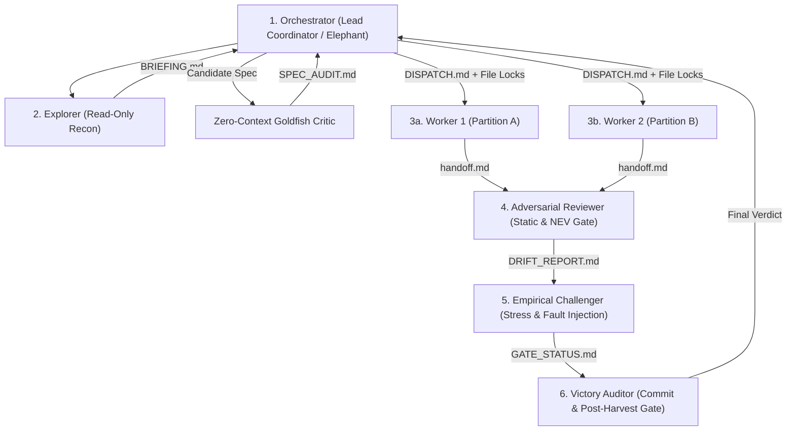

# 🤝 Multi-Agent Teamwork & Adversarial Orchestration Protocol

**Goal:** Establish a deterministic, zero-collision multi-agent execution architecture scaling from single-agent fast paths to 6-role adversarial teams while eliminating git merge conflicts, context pollution, and rubber-stamp reviews.

---

## 1. System 1 Complexity Threshold & Team Sizing Matrix

Before spawning subagents, the Orchestrator MUST evaluate blast radius, file count, and epistemic uncertainty to select the minimum viable topology:

| Topology Tier | Trigger Conditions | Active Roles Spawned | Coordination Overhead |
| :--- | :--- | :--- | :--- |
| **Tier 0: Solo Fast-Path** | $\le 3$ files touched, single module, deterministic bugfix/config | `Single Agent` (No subagents) | $0$ tokens (Direct execution) |
| **Tier 1: Execution + Review Dyad** | $4\text{–}8$ files touched, single domain feature, moderate refactor | `Orchestrator/Worker` + `Adversarial Reviewer` | Low ($1$ verification handoff) |
| **Tier 2: Parallel Partitioned Squad** | $9\text{–}25$ files across $\ge 2$ disjoint modules or polyglot tiers | `Orchestrator` + $2\text{–}4\times$ `Worker` + `Adversarial Reviewer` | Medium (`DISPATCH.md` lock table) |
| **Tier 3: Full 6-Role Sovereign Team** | $> 25$ files, repo-wide audit, architecture migration, or security kernel | `Orchestrator`, `Explorer`, `Worker(s)`, `Adversarial Reviewer`, `Empirical Challenger`, `Victory Auditor` | High (Full 4-artifact contract) |

---

## 2. The 6-Role Sovereign Topology



1. **Orchestrator (`multi-agent-orchestrator`):** Owns problem decomposition, maintains the deep-context session (Elephant), coordinates design specifications, enforces the exclusive file-ownership lock matrix, dispatches workers via `invoke_subagent`, resolves cross-partition contract disputes, and executes the final `git commit`.
2. **Explorer (`research` subagent):** Executes parallel read-only recon (`grep_search`, `view_file`), maps call graphs, and synthesizes findings into `BRIEFING.md` without polluting Orchestrator context.
3. **Goldfish Spec Critic (`goldfish-spec-critic`):** Zero-context architectural gatekeeper evaluating candidate specs across 4 stages (Zoom Out, Comprehension, Critic, Readiness) to eliminate tacit assumptions and self-review bias before any worker edits code.
4. **Worker (`self` / Specialist):** Executes bounded edits strictly within its assigned file lock partition ($P_i$). Prohibited from touching out-of-partition files or running `git commit`.
5. **Adversarial Reviewer (`adversarial-code-reviewer`):** Audits worker diffs against `R_*` standards, Net Engineering Value (`R_NEV`), abstraction tax limits, cross-module coupling, and computes design drift against the approved spec (`DRIFT_REPORT.md`).
6. **Empirical Challenger (`cognitive-loop-challenger`):** Designs hostile boundary inputs, concurrency stress tests, fault-injection harnesses, and module-deletion checks to falsify worker claims.
7. **Victory Auditor:** Performs final pre-commit verification (`0` compiler warnings, `100%` test pass rate, zero secret leakage, zero unapproved drift) before authorizing commit and SemanticBrain post-harvest.

---

## 3. Zero-Collision File Ownership Lock Matrix

> [!IMPORTANT]
> **Cardinal Law of Parallel Execution (`R_TEAM`):** Two concurrent Workers MUST NEVER hold write permissions (`write_to_file`, `replace_file_content`) to the same file simultaneously ($\forall i \neq j, P_i \cap P_j = \emptyset$).

- **Shared Root Reservation:** Root registries (`index.json`, `Program.cs`, `App.tsx`, `Cargo.toml`) are **Reserved Orchestrator-Only Files** wired after parallel worker partitions finish.
- **Read-Before-Write Invariant:** Every Worker must call `view_file` on any existing file in its partition before calling `replace_file_content`.

| Worker ID | Assigned Role | Exclusive Write Partition ($P_i$) | Read-Only Scope | Forbidden Actions |
| :--- | :--- | :--- | :--- | :--- |
| `Worker-1` | Backend API | `Features/Orders/**` | `Shared/Contracts/**` | Editing `Program.cs`, `git commit` |
| `Worker-2` | Frontend UI | `src/pages/orders/**` | `Shared/Contracts/**` | Editing `src/App.tsx`, `git commit` |
| `Orchestrator` | Coordinator | `Program.cs`, `src/App.tsx`, `index.json` | Entire Repository | Delegating shared root wiring |

---

## 4. Structured Handoff Artifact Contracts

1. **`BRIEFING.md` (Explorer $\to$ Orchestrator):** Exact file paths, line ranges, symbol signatures, architectural invariants, and SemanticBrain historical gotchas.
2. **`SPEC_AUDIT.md` (Goldfish Critic $\to$ Orchestrator):** 4-stage spec review scorecard (Zoom Out, Comprehension, Critic, Readiness) ensuring zero-context self-containment before worker dispatch.
3. **`DISPATCH.md` (Orchestrator $\to$ Workers):** Mission scope, explicit file ownership list, quantitative acceptance criteria (byte budgets, latency targets, rule tags), and prohibited actions.
4. **`handoff.md` (Worker $\to$ Orchestrator & Reviewer):** Completion report listing every created/modified file, line diff summary, and local verification outputs.
5. **`DRIFT_REPORT.md` (Reviewer $\to$ Challenger & Victory Auditor):** Design drift analysis ($\text{Drift} = \text{Diff} \setminus \text{Spec}$) identifying unapproved additions or missing invariants.
6. **`GATE_STATUS.md` (Reviewer & Challenger $\to$ Victory Auditor):** 4-stage verification scorecard, defect table (`P0 Blocker`, `P1 Major`, `P2 Nit`), and empirical test/build stdout proofs.

---

## 5. The 4-Stage Adversarial Verification Gate

```text
[Stage 1: Partition Lock & Boundary Audit]      ──► 0 out-of-scope file edits; 0 merge collisions
                        │
                        ▼
[Stage 2: Static Conformance, NEV & Drift Audit]──► 100% R_* compliance; NEV > 0; Drift == 0; 0 broken refs
                        │
                        ▼
[Stage 3: Empirical Stress & Build Proof]       ──► Compiler exit 0; 100% tests pass; boundary stress
                        │
                        ▼
[Stage 4: Victory Audit & Atomic Commit]        ──► Orchestrator wires root index -> git-safe-commit
```

- **Design Drift Invariant:** Code changes must strictly correspond to the approved specification. Unapproved additions outside the spec without user authorization fail Stage 2 as scope creep.
- **Remediation Loop:** If Stage 2 or Stage 3 flags a `P0`/`P1` defect, the Orchestrator sends remediation instructions back to the owning Worker's existing `conversationId` via `send_message` and re-runs the gate.
