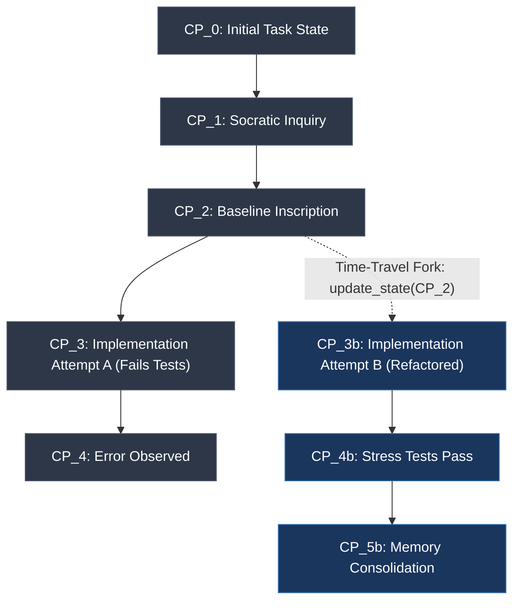

# Sovereign Cognitive & Execution Patterns: Comprehensive Architectural Study of Open-Source AI Agent Design Repositories

**Document ID:** `AGENT-DESIGN-REPOS-STUDY-2026`  
**Classification:** Definitive Production Architecture Research Study  
**Standard:** Standard Technical English (Rigorous, Formal, Zero Placeholders)  
**Target Repository:** `E:\16. AgentOption`  
**Referenced Frameworks:** LangGraph, Microsoft AutoGen v0.4, Anthropic Agent Workflows, Aider, OpenHands (OpenDevin), SWE-agent, Letta (MemGPT), Mem0, SemanticBrain, and AgentOption Core.

---

## Table of Contents
1. [Executive Summary & Conceptual Taxonomy of Autonomous Agents](#1-executive-summary--conceptual-taxonomy-of-autonomous-agents)
   - 1.1 The Evolutionary Trajectory of Agentic Architectures
   - 1.2 The Three Pillars of Production AI Agents
   - 1.3 Master Conceptual Taxonomy Diagram
2. [Pillar 1: Orchestration, Cyclic State Graphs & Actor Models](#2-pillar-1-orchestration-cyclic-state-graphs--actor-models)
   - 2.1 LangGraph: Bulk Synchronous Parallel (BSP) & State Graphs
   - 2.2 Microsoft AutoGen v0.4: Asynchronous Actor Model & Event Bus
   - 2.3 Anthropic Agent Workflows: Structural Compositional Primitives
   - 2.4 Pillar 1 Cross-Paradigm Architectural Comparison
3. [Pillar 2: Practical Coding Agent Harnesses & Interfaces](#3-pillar-2-practical-coding-agent-harnesses--interfaces)
   - 3.1 Aider: Git-Native State & AST PageRank Repo Mapping
   - 3.2 OpenHands (OpenDevin): Sandboxed Reactive Event Streams
   - 3.3 SWE-agent: Agent-Computer Interface (ACI) & Token Governance
   - 3.4 Pillar 2 Practical Coding Harness Comparative Matrix
4. [Pillar 3: Tiered Cognitive Memory & Context Governance](#4-pillar-3-tiered-cognitive-memory--context-governance)
   - 4.1 Letta (MemGPT): Hierarchical OS Memory Architecture
   - 4.2 Mem0: Dynamic Knowledge Graph Synthesis & Fact Mutation
   - 4.3 Negative Knowledge & Dead-Loop Prevention
   - 4.4 Pillar 3 Cognitive Memory Comparative Matrix
5. [Comprehensive Cross-Cutting Architectural Trade-Off Matrices](#5-comprehensive-cross-cutting-architectural-trade-off-matrices)
   - 5.1 Formal 4-Dimensional Evaluation Rubrics (1–5 Scale)
   - 5.2 Master Comparative Scorecard
   - 5.3 In-Depth Qualitative Justification by Dimension
   - 5.4 Pareto Trade-Off Tension Analysis
6. [Universal Failure Mode & Anti-Pattern Catalog](#6-universal-failure-mode--anti-pattern-catalog)
   - 6.1 Anti-Pattern 1: Blind Re-Prompting / Chatty Retry Loop
   - 6.2 Anti-Pattern 2: Context Satiation & Attention Evaporation (Token Blowout)
   - 6.3 Anti-Pattern 3: Unconstrained ReAct & Ping-Pong Oscillations
   - 6.4 Anti-Pattern 4: Flat Memory Amnesia
   - 6.5 Anti-Pattern 5: Phantom Edits & Line Arithmetic Failures
   - 6.6 Cross-Cutting Anti-Pattern Comparative Matrix
7. [Synthesis Principles & Architectural Bridges for AgentOption](#7-synthesis-principles--architectural-bridges-for-agentoption)
   - 7.1 The 5 High-Level Architectural Synthesis Principles
   - 7.2 Production Blueprint Component Specifications (Components A–D)
   - 7.3 Integration Alignment with Existing AgentOption SSoTs
8. [Verification, Provenance & Reference Bibliography](#8-verification-provenance--reference-bibliography)
   - 8.1 Primary Codebases and Literature Inspected
   - 8.2 Audit and Verification Directives

---

## 1. Executive Summary & Conceptual Taxonomy of Autonomous Agents

### 1.1 The Evolutionary Trajectory of Agentic Architectures
The discipline of Large Language Model (LLM) engineering has experienced a rapid structural evolution, transitioning across three distinct architectural paradigms:

1. **The Naive Linear Era (2022–2023):**  
   Initial implementations relied on single-turn completions, static chain-of-thought prompts, and rigid Directed Acyclic Graphs (DAGs), such as early LangChain Chains or basic OpenAI function-calling scripts. These systems suffered from severe brittleness: execution was strictly unidirectional, speculative branching was impossible, and any intermediate step failure caused total system abort.

2. **The Unconstrained Autonomous ReAct Era (2023–2024):**  
   To achieve adaptability, systems pivoted to open-ended Thought-Action-Observation loops (e.g., AutoGPT, BabyAGI, and standard ReAct prompts). While flexible, these architectures introduced catastrophic operational failure modes: unbounded context blowout, semantic repetition loops, hallucinated tool invocations, rapid token exhaustion, and non-deterministic behavior that rendered them unviable for production engineering.

3. **The Governed Cognitive Systems Era (2024–2026):**  
   Production-grade autonomous engineering agents now treat foundation models not as autonomous drivers, but as cognitive microprocessors (CPUs) embedded within rigorous, deterministic software harnesses. Modern architectures decouple state, perception, and memory into three mutually reinforcing pillars:
   - **Pillar 1 (Orchestration & State):** Cyclic state graphs with Bulk Synchronous Parallel execution (LangGraph), asynchronous actor models with strongly typed message buses (AutoGen v0.4), and deterministic compositional workflow primitives (Anthropic).
   - **Pillar 2 (Harnesses & Interfaces):** High-density, low-noise Agent-Computer Interfaces (SWE-agent), AST-indexed repository symbol graphs prioritized via PageRank (Aider), and containerized event-stream runtimes (OpenHands).
   - **Pillar 3 (Memory & Context Governance):** Hierarchical virtual operating system memory models (Letta), dynamic entity-relation graphs with temporal conflict resolution (Mem0), episodic failure graveyards (Negative Knowledge), and dual-engine stagnation circuit breakers.

### 1.2 The Three Pillars of Production AI Agents
A robust autonomous software engineering system cannot rely on prompt engineering alone. It requires the co-equal integration of all three foundational pillars:

```
┌────────────────────────────────────────────────────────────────────────────────────────┐
│                        GOVERNED AGENTIC COGNITIVE ARCHITECTURE                         │
├────────────────────────────────────────────────────────────────────────────────────────┤
│                                                                                        │
│   ┌────────────────────────────────────────────────────────────────────────────────┐   │
│   │                 PILLAR 1: ORCHESTRATION & STATE CONTROL GRAPH                  │   │
│   │                                                                                │   │
│   │   [StateGraph (Pregel BSP)] ◄───► [Actor Message Bus] ◄───► [Anthropic Flows] │   │
│   │   • Supersteps & Barriers         • Topic Pub/Sub Routing   • Orchestrator/    │   │
│   │   • Channel Reducers              • Single-Thread Mailbox     Workers Loop     │   │
│   │   • Checkpointing & Time-Travel   • Isolated Actor State    • Evaluator-Opt    │   │
│   └───────────────────────┬────────────────────────────────┬───────────────────────┘   │
│                           │ Dispatches Tasks               │ Injects Middleware        │
│                           ▼                                ▼                           │
│   ┌────────────────────────────────────────────────────────────────────────────────┐   │
│   │                 PILLAR 2: PRACTICAL CODING HARNESSES & ACI                     │   │
│   │                                                                                │   │
│   │   [Context Engine (Aider)]      [Runtime Sandbox (OpenHands)] [ACI (SWE-agent)]│   │
│   │   • Tree-sitter AST Tags        • EventStream (Action/Obs)   • Windowed View   │   │
│   │   • Personalized PageRank       • MicroVM/Docker Isolation   • Output Ceilings │   │
│   │   • Architect/Editor Split      • Deterministic Replay       • In-Loop Linters │   │
│   └───────────────────────┬────────────────────────────────┬───────────────────────┘   │
│                           │ Emits Observations             │ Queries / Records State   │
│                           ▼                                ▼                           │
│   ┌────────────────────────────────────────────────────────────────────────────────┐   │
│   │                 PILLAR 3: TIERED COGNITIVE MEMORY & CONTEXT GOVERNANCE         │   │
│   │                                                                                │   │
│   │   [Hierarchical OS Memory]      [Dynamic Knowledge Graph]    [Negative Guard]  │   │
│   │   • T0: Resident Core Blocks    • T1: Session Event Stream   • T2: Failure     │   │
│   │     (Persona, Scratchpad)       • Entity Mutation CRUD         Graveyard       │   │
│   │   • Quota-Guarded Self-Edit     • Hybrid Retrieval (Dense/   • Zobrist Hashing │   │
│   │   • Paged Context Compaction      Sparse/Graph + RRF)        • Cosine Stagnat. │   │
│   └────────────────────────────────────────────────────────────────────────────────┘   │
│                                                                                        │
└────────────────────────────────────────────────────────────────────────────────────────┘
```

### 1.3 Master Conceptual Taxonomy Diagram
The taxonomy of autonomous agent frameworks maps each surveyed repository to its primary architectural specializations:

| System / Framework | Primary Architectural Archetype | Core Mechanism | SSoT Persistence Model | Primary Failure Defenses |
| :--- | :--- | :--- | :--- | :--- |
| **LangGraph** | Cyclic State Machine (BSP) | Pregel supersteps, typed channels, associative reducers | `BaseCheckpointSaver` (Postgres/SQLite/Memory) | Monotonic channel versioning, recursion limits, HITL `interrupt()` |
| **Microsoft AutoGen v0.4** | Asynchronous Actor Model | Single-threaded mailboxes, topic pub/sub, distributed gRPC | Actor-local state snapshots, event bus replay | Composable boolean termination conditions, isolated actor queues |
| **Anthropic Agent Workflows** | Compositional Workflow Patterns | Workflows vs Agents separation, 5 canonical blocks | Application-managed (Host DB, Git, Redis) | Programmatic validation gates, Evaluator-Optimizer loops, routing |
| **Aider** | Git-Native Coding Harness | Tree-sitter AST symbol graph, Personalized PageRank | Git transactional ledger (`HEAD`, branch, commit) | Git-native atomic auto-commits, `/undo` rollback, 1,024-token knapsack |
| **OpenHands (OpenDevin)** | Sandboxed Reactive Platform | Append-only `EventStream`, Action/Observation events | Relational event log, Docker workspace snapshots | MicroVM/Docker kernel isolation, event replayability, exit status trap |
| **SWE-agent** | Standardized ACI Harness | Low-noise windowed commands, exit code trapping | Git patch submission, in-process file buffers | Hard 100-line output ceiling, middle suppression, AST linter reversal |
| **Letta (MemGPT)** | Virtual OS Memory Hierarchy | Tiered context blocks, self-editing memory tool loops | PostgreSQL/SQLite relational memory storage | Character quotas per block, recursive compaction at 75% window |
| **Mem0** | Dynamic Knowledge Graph Engine | (Subject, Predicate, Object) triplets, temporal CRUD | Graph DB (Neo4j/Qdrant) + Dense Vector Embeddings | Temporal edge expiration (`valid_until`), RRF hybrid retrieval |
| **AgentOption (Core)** | Governed Engineering OS | 5-Phase Cognitive Loop, 8-Entity Schema, SemanticBrain | Git SSoT (`rules.json`, `.research-memory.json`, AME) | Zobrist cycle hash, cosine stagnation matrix ($\Delta I \le 0.15$), atomic rollback |

---

## 2. Pillar 1: Orchestration, Cyclic State Graphs & Actor Models

### 2.1 LangGraph: Bulk Synchronous Parallel (BSP) & State Graphs
LangGraph fundamentally departs from Directed Acyclic Graph (DAG) engines by recognizing that software engineering and debugging require **cyclic state machines**. Human and agentic problem solving is inherently speculative, iterative, and non-linear.

```
       ┌────────────────────────────────────────────────────────┐
       │                 LangGraph Runtime                      │
       │                                                        │
       │   ┌────────────────────────────────────────────────┐   │
       │   │           Pregel Execution Engine              │   │
       │   │  Superstep (t) ──► Barrier ──► Superstep (t+1) │   │
       │   └───────────────────────┬────────────────────────┘   │
       │                           │ Reads/Writes               │
       │                           ▼                            │
       │   ┌────────────────────────────────────────────────┐   │
       │   │           State Channels & Reducers            │   │
       │   │   [messages]  [plan]  [iteration]  [artifacts] │   │
       │   └───────────────────────┬────────────────────────┘   │
       │                           │ Snapshots                  │
       │                           ▼                            │
       │   ┌────────────────────────────────────────────────┐   │
       │   │       BaseCheckpointSaver (Sqlite/Postgres)    │   │
       │   │   Thread ID · Checkpoint ID · Channel Versions │   │
       │   └────────────────────────────────────────────────┘   │
       └────────────────────────────────────────────────────────┘
```

#### 2.1.1 StateGraph vs. MessageGraph & Channel Primitives
- **`StateGraph(state_schema)`:** Parameterized by an arbitrary schema (Python `TypedDict`, `dataclass`, or Pydantic `BaseModel`). Each field represents an independent, typed **Channel** managed by a specific **Reducer**.
- **`MessageGraph`:** A specialized convenience wrapper where state is constrained to a single channel: `Sequence[BaseMessage]`, configured with an append reducer (`operator.add` or `add_messages`).
- **Core Channel Types:**
  1. `LastValue[T]` (Default): Retains strictly the most recent value written. Concurrent writes by multiple nodes during the same superstep raise an `InvalidUpdateError` due to ambiguous overwriting.
  2. `BinaryOperatorAggregate[T]`: Accumulates updates using an associative binary reduction function $\mathcal{R}(a, b) \to c$ (e.g., `Annotated[list, operator.add]`).
  3. `EphemeralValue[T]`: Retains value strictly during the immediate superstep transition and resets to default on the subsequent step; critical for firing transient event triggers without polluting durable state.
  4. `Topic[T]`: Append-only sequence modeling pub/sub event streams within the graph, accumulating signals across supersteps until explicitly cleared.

#### 2.1.2 Pregel Execution Semantics
LangGraph adapts Google's **Pregel** Bulk Synchronous Parallel (BSP) framework for agent cognition. Execution proceeds through synchronized iterations termed **Supersteps**:

$$\text{Execution} = \langle S_0, S_1, S_2, \dots, S_N \rangle$$

Within each Superstep $S_t$:
1. **Frontier Resolution:** The runtime inspects active node subscriptions. Any node that received input signals or edge activations from Superstep $S_{t-1}$ is scheduled in the active frontier $\mathcal{F}_t = \{N_1, N_2, \dots, N_k\}$.
2. **Parallel Task Execution:** All nodes in $\mathcal{F}_t$ execute concurrently (via `asyncio.gather` or worker pools):
   $$f_i(State_t) \to \text{ChannelUpdates}_i$$
   Nodes read from the immutable state snapshot $State_t$ captured at the start of the superstep. Writes performed by sibling nodes in the same superstep are strictly invisible.
3. **Synchronization Barrier:** The runtime halts all execution until all active nodes in $\mathcal{F}_t$ complete or raise exceptions.
4. **Channel Reducer Application:** Writes from all completed nodes are grouped by channel. For each channel $C_j$:
   $$C_j^{(t+1)} = \mathcal{R}_j\left(C_j^{(t)}, \{u_{i,j} \mid N_i \in \mathcal{F}_t\}\right)$$
5. **Monotonic Version Increment:** Every channel updated increments its monotonic version counter:
   $$V(C_j) \leftarrow V(C_j) + 1$$
6. **Checkpoint Commit:** If a checkpointer is bound, a discrete checkpoint record $CP_{t+1}$ is atomically persisted.
7. **Edge & Condition Routing:** Evaluates fixed edges ($A \to B$) and conditional routers ($\text{route}(State_{t+1}) \to \mathcal{F}_{t+1}$) to establish the active frontier for Superstep $S_{t+1}$.
8. **Halt Condition Check:** Execution terminates if $\mathcal{F}_{t+1} = \emptyset$, if `END` is reached, if an interrupt is tripped, or if $t \ge \text{recursion\_limit}$.

#### 2.1.3 Checkpointing Infrastructure & State Persistence
All persistence in LangGraph implements the abstract base contract `BaseCheckpointSaver`:
- `get_tuple(config: RunnableConfig) -> Optional[CheckpointTuple]`: Fetches a complete checkpoint snapshot including channel values, metadata, parent pointer, and uncommitted writes.
- `list(config, before, limit) -> Iterator[CheckpointTuple]`: Traverses the historical execution lineage backwards from a given checkpoint.
- `put(config, checkpoint, metadata, new_versions) -> RunnableConfig`: Persists a newly committed superstep state.
- `put_writes(config, writes, task_id) -> None`: Persists intermediate, uncommitted writes for transactional crash recovery.

Checkpoints are indexed via a compound tuple:
$$\text{StorageKey} = \langle \text{thread\_id}, \text{checkpoint\_ns}, \text{checkpoint\_id} \rangle$$
Where `checkpoint_id` is a time-sortable UUIDv7 or ULID, establishing total causal ordering:
$$CP_0 \prec CP_1 \prec CP_2 \prec \dots \prec CP_t$$

#### 2.1.4 Time-Travel Debugging, State Forking & Human-in-the-Loop (HITL)
Because every superstep generates an immutable, parent-linked checkpoint record $CP_t = \langle \text{id}_t, \text{parent\_id}_{t-1}, State_t \rangle$, execution forms a directed acyclic tree of state history.



- **Rewind:** Passing an older `checkpoint_id` to `graph.invoke(None, config={"configurable": {"thread_id": "t1", "checkpoint_id": "CP_2"}})` executes from that historical snapshot without altering past records.
- **State Forking:** Calling `graph.update_state(config, values={"patch": "alternate_solution"}, as_node="node_explorer")` forks execution: checkpoint $CP_2$ remains immutable, a new checkpoint $CP_{3b}$ is written with $\text{parent\_id} = CP_2$, and subsequent execution advances down the branch $\{CP_{3b}, CP_{4b}\}$, leaving the failed trajectory intact for post-mortem analysis.
- **Human-in-the-Loop Mechanics:**
  - *Static Interrupts:* `interrupt_before` and `interrupt_after` halt execution at node boundaries.
  - *Dynamic Interrupts:* A node calls `interrupt(payload)` mid-function. The runtime captures the payload, suspends execution, commits the current checkpoint, and exits the execution loop.
  - *Resumption via `Command`:* Resuming occurs via `graph.invoke(Command(resume=human_feedback), config=...)`. The value supplied to `resume` is injected directly as the return value of the suspended `interrupt()` expression inside the node.

#### 2.1.5 Multi-Agent Coordination Topologies
LangGraph supports four canonical multi-agent topologies:
1. **Centralized Supervisor:** A dedicated supervisor LLM inspects current task progress, routes to the next specialized worker subgraph, and evaluates completion. All communication flows back through the supervisor hub.
2. **Peer-to-Peer Mesh (Swarm):** Agents communicate directly via state handoffs. Each node returns a `Command(goto="next_agent", update={...})`. Eliminates the supervisor token bottleneck, but increases risk of chaotic oscillation without convergence guards.
3. **Hierarchical Multi-Agent Teams:** Subgraphs are compiled independently with localized state schemas and nested checkpointer namespaces, then embedded as nodes inside a higher-level supervisor graph. Provides strict encapsulation of working memory.
4. **Single Cyclic ReAct Agent:** A two-node loop (`Agent` $\rightleftharpoons$ `Tools`). The agent emits tool calls; the tool node executes them and returns tool messages; repeats until the agent outputs final text.

---

### 2.2 Microsoft AutoGen v0.4: Asynchronous Actor Model & Event Bus
Microsoft overhauled AutoGen in version 0.4. The legacy v0.2 monolithic architecture—centered around synchronous, tightly-coupled `ConversableAgent` instances calling `send()` in blocking Python loops—was replaced with an **event-driven, distributed, asynchronous Actor Model** (`autogen-core`).

```
       ┌────────────────────────────────────────────────────────┐
       │              AutoGen v0.4 Actor Runtime                │
       │                                                        │
       │   ┌────────────────────────────────────────────────┐   │
       │   │           Topic-Based Message Bus              │   │
       │   │  publish_message()  ──►  Type / Topic Routing   │   │
       │   └──────────────┬──────────────────┬──────────────┘   │
       │                  │                  │                  │
       │                  ▼ Mailbox          ▼ Mailbox          │
       │         ┌─────────────────┐┌─────────────────┐         │
       │         │  RoutedAgent A  ││  RoutedAgent B  │         │
       │         │  (Single-Task)  ││  (Single-Task)  │         │
       │         └─────────────────┘└─────────────────┘         │
       │                  │                  │                  │
       │                  └──────────┬───────┘                  │
       │                             ▼                          │
       │   ┌────────────────────────────────────────────────┐   │
       │   │      Distributed Runtime (gRPC / Dapr / IPC)   │   │
       │   └────────────────────────────────────────────────┘   │
       └────────────────────────────────────────────────────────┘
```

#### 2.2.1 The Asynchronous Actor Model (`autogen-core`)
The Actor Model (Hewitt, Bishop, Steiger, 1973) treats "Actors" as universal primitives of concurrent computation:
- An actor maintains private, encapsulated state.
- An actor communicates with other actors strictly via asynchronous message passing.
- An actor possesses an internal mailbox (queue) and processes exactly one message at a time sequentially.
- In response to a message, an actor can: (1) mutate its private state, (2) send messages to known addresses, or (3) spawn child actors.

#### 2.2.2 AgentId, RoutedAgent & Strongly Typed Message Handlers
- **`AgentId`:** The unique address of an actor, defined as a composite pair:
  $$\text{AgentId} = \langle \text{type: str}, \text{key: str} \rangle$$
  For example, `AgentId("explorer", "task-8492")`.
- **`RoutedAgent`:** Dispatches strongly typed Pydantic payloads using `@message_handler` decorators:

```python
from autogen_core import RoutedAgent, message_handler, MessageContext
from pydantic import BaseModel

class HypothesisPayload(BaseModel):
    id: str
    statement: str
    expected_gain: float

class VerificationResult(BaseModel):
    id: str
    passed: bool
    delta_metric: float

class ExplorerActor(RoutedAgent):
    def __init__(self, key: str) -> None:
        super().__init__("ExplorerAgent")
        self._key = key
        self._history: list[str] = []

    @message_handler
    async def handle_hypothesis(self, message: HypothesisPayload, ctx: MessageContext) -> VerificationResult:
        self._history.append(message.statement)
        # Bounded evaluation logic...
        return VerificationResult(id=message.id, passed=True, delta_metric=0.15)
```

#### 2.2.3 Topic-Based Pub/Sub Event Bus & Distributed Runtime Tiers
- **`TopicId`:** Identifies an event stream:
  $$\text{TopicId} = \langle \text{type: str}, \text{source: str} \rangle$$
- Broadcasts are executed via `publish_message(message, topic_id)`; point-to-point delivery uses `send_message(message, recipient_agent_id)`.
- **Runtime Tiers:**
  1. `SingleThreadedAgentRuntime`: In-process cooperative event loop (`asyncio`) for deterministic testing with zero network overhead.
  2. `WorkerAgentRuntime`: Distributes actors across processes, Docker containers, or VMs via gRPC channels.
  3. Multi-Host Clustering: Scales compute-intensive agents or sandboxed code environments across nodes with unified topic addressing.

#### 2.2.4 Declarative Termination Conditions & Safety Interceptors
Conversations are governed by explicit, composable boolean termination conditions:
$$\text{TermCondition} = (\text{TextMentionTermination}(\text{"TERMINATE"}) \mid \text{MaxMessageTermination}(15)) \ \& \ \text{TokenUsageTermination}(100000)$$
Human intervention is non-blocking: when confirmation is required, an agent publishes a `UserInputRequestedEvent`; the runtime suspends dispatch until a `UserInputReceivedEvent` is received.

---

### 2.3 Anthropic Agent Workflows: Structural Compositional Primitives
In "Building Effective Agents" (Anthropic, 2024), Erik Schluntz and Barry Zhang articulate a foundational distinction that defines production LLM systems: **Workflows vs. Autonomous Agents**.

```
                THE SPECTRUM OF AGENTIC AUTONOMY
   ┌─────────────────────────────────────────────────────────────┐
   │                                                             │
   │  Deterministic                                              │  Fully
   │  Code Logic ◄─────────────────────────────────────────────► Autonomous
   │                                                             │  LLM Loops
   └───────┬─────────────────────────────────────────────┬───────┘
           │                                             │
           ▼                                             ▼
   WORKFLOW PATTERNS                             AUTONOMOUS AGENTS
   • Prompt Chaining                             • Open-ended ReAct
   • Routing                                     • Unconstrained Tool Loops
   • Parallelization (Sectioning/Voting)         • Dynamic Goal Reformulation
   
   Properties:                                   Properties:
   • High Predictability                         • High Adaptability
   • Low Latency & Token Cost                    • High Token Consumption
   • Deterministic Error Recovery                • Stochastic Failure Drift
```

#### 2.3.1 Workflows vs. Autonomous Agents
- **Workflows:** Systems where LLMs and tools are orchestrated through **predetermined, programmatic execution paths** (DAGs, validation gates, conditional code logic). Code controls the flow; LLMs generate content or perform bounded classifications.
- **Autonomous Agents:** Systems where the LLM **dynamically directs its own execution path**, choosing which tools to invoke, whether to backtrack, and when to terminate across an open-ended loop.
- **The Golden Architectural Rule:**  
  > *"Default to the simplest workflow pattern that accomplishes the objective. Introduce autonomous agent loops only where dynamic adaptability yields verified informational gain that exceeds the cost of non-determinism."*

#### 2.3.2 The 5 Canonical Building Blocks
1. **Prompt Chaining:** Decomposes a task into a linear sequence of LLM calls separated by programmatic validation gates. If validation fails, code retries or aborts without corrupting subsequent steps.
2. **Routing:** Classifies incoming queries to direct them to specialized prompts, tools, or model tiers (e.g., routing simple lookups to Claude 3.5 Haiku and complex reasoning to Claude 3.5 Sonnet).
3. **Parallelization:** 
   - *Sectioning:* Divides a task into independent subtasks executed concurrently, aggregating the outputs.
   - *Voting (Consensus):* Executes multiple independent model calls and tallies consensus (e.g., multi-pass security audits).
4. **Orchestrator-Workers:** A central orchestrator LLM dynamically plans subtasks, dispatches worker LLMs concurrently, and synthesizes incoming results.
5. **Evaluator-Optimizer:** A closed feedback loop between a **Generator** persona and an **Evaluator** persona (or test suite). The evaluator returns actionable critique tokens until the acceptance criteria are met.

---

### 2.4 Pillar 1 Cross-Paradigm Architectural Comparison

| Architectural Dimension | LangGraph (Cyclic State Graph) | Microsoft AutoGen v0.4 (Actor Model) | Anthropic Patterns (Workflows/Agents) |
| :--- | :--- | :--- | :--- |
| **Primary Execution Model** | Synchronized Bulk Synchronous Parallel (BSP) / Pregel Supersteps | Asynchronous, event-driven Actor Model with single-threaded mailboxes | Flexible compositional DAGs, trees, and feedback loops |
| **State Paradigm** | Centralized, channel-based, thread-isolated typed state dictionary | Decentralized, private actor state; communication via immutable messages | Transient prompt contexts; external state passed via programmatic variables |
| **Persistence & Checkpointing** | First-class `BaseCheckpointSaver` (Memory, SQLite, PostgreSQL) with channel versions | Actor-local state persistence; event store / topic log replay | Application-level persistence (DB, Redis, Git commits) |
| **Cycle Handling** | Native cyclic edges; regulated by `recursion_limit` and channel reducers | Dynamic cyclic conversations; regulated by composable termination conditions | Explicit Evaluator-Optimizer loops or code-level `while` loops |
| **Rollback & Time-Travel** | Native state forking; rewind to any `checkpoint_id` and branch execution | Requires event sourcing replay or actor snapshot reconstruction | Git-based rollback or explicit state snapshot variables |
| **Human-in-the-Loop (HITL)** | Native `interrupt()` and `Command(resume=...)` primitives | Asynchronous `UserInputRequestedEvent` and `UserProxyAgent` | Programmatic input gates between workflow steps |
| **Multi-Agent Coordination** | Supervisor, Peer-to-Peer Swarm, or Hierarchical Subgraphs | Pub/Sub Topic Message Bus, GroupChat (RoundRobin, Selector), Swarm | Orchestrator-Workers, Router, or Evaluator-Optimizer |
| **Concurrency Model** | Barrier synchronization per superstep; parallel node execution | Purely asynchronous, uncoordinated actors; concurrent message queues | Async task gathering (`asyncio.gather`) across parallel branches |
| **Language & Ecosystem** | Python, TypeScript/JavaScript | Python (`autogen-core`, `autogen-agentchat`), .NET | Language agnostic (pure architectural patterns) |
| **Primary Failure Mode** | State channel merge conflicts; infinite loops if conditional edges stall | Deadlocks on unhandled topics; runaway message storm on pub/sub | Brittle parsing gates on prompt chains; prompt drift |

---

## 3. Pillar 2: Practical Coding Agent Harnesses & Interfaces

### 3.1 Aider: Git-Native State & AST PageRank Repo Mapping
Aider represents the gold standard for lightweight, git-centric coding assistance. Its architecture resolves two fundamental bottlenecks: (1) repository-wide context without overflowing context windows, and (2) applying code changes with near-zero syntax corruption.

```
┌────────────────────────────────────────────────────────────────────────┐
│                          AIDER ARCHITECTURE                            │
├────────────────────────────────────────────────────────────────────────┤
│                                                                        │
│   [Source Files] ──► [Tree-sitter Parser]                              │
│                             │                                          │
│                             ▼                                          │
│                    [Tag Extraction Engine]                             │
│                     • Definitions (defs)                               │
│                     • References (refs)                                │
│                             │                                          │
│                             ▼                                          │
│                    [Symbol Graph G=(V,E)]                              │
│                             │                                          │
│                             ▼                                          │
│             [Personalized PageRank Centrality]                         │
│             • Seed Set: Active/Chat Files                              │
│             • Token Budget: Configurable (e.g. 1024)                   │
│                             │                                          │
│                             ▼                                          │
│                  [Token-Bounded Repo Map]                              │
│                             │                                          │
│    User Request ────────────┼──────────────────────────────┐           │
│                             ▼                              ▼           │
│                 ┌───────────────────────┐      ┌─────────────────────┐ │
│                 │   ARCHITECT MODEL     │      │    EDITOR MODEL     │ │
│                 │ (High-Capacity Core)  │      │ (Fast Diff Engine)  │ │
│                 │ Reasoning & Strategy  │      │ Search/Replace App  │ │
│                 └───────────┬───────────┘      └──────────┬──────────┘ │
│                             │ Plan / Changeset            │ Patches    │
│                             └─────────────────────────────►            │
│                                                           │            │
│                                                           ▼            │
│                                                [Git State Management]  │
│                                                • Atomic Auto-Commit    │
│                                                • /undo Rollback        │
└────────────────────────────────────────────────────────────────────────┘
```

#### 3.1.1 Tree-sitter AST Repository Mapping (Defs vs. Refs)
Aider rejects naive approaches like embedding every file or dumping raw directory trees. Using Tree-sitter parsers across 20+ languages, it extracts semantic identifier tags:
- **Definitions ($\text{defs}(f)$):** Class declarations, interface signatures, function declarations, top-level constants.
- **References ($\text{refs}(f)$):** Function invocations, instantiated types, imported symbols, inheritance specifiers.

From these tags, Aider constructs a directed multigraph $G = (V, E)$:
- **Vertices ($V$):** Every source file in the repository ($V = \mathcal{F}$).
- **Directed Edges ($E$):** An edge $e = (f_i, f_j) \in E$ exists from file $f_i$ to file $f_j$ if file $f_i$ references a symbol defined in file $f_j$:
  $$\exists s \in \text{refs}(f_i) \quad \text{such that} \quad s \in \text{defs}(f_j)$$
- **Edge Weight ($W(f_i, f_j)$):** Weighted by symbol specificity $w(s)$ (rare symbols carry higher weight than generic identifiers like `id` or `data`).

#### 3.1.2 Mathematical Formulation of Personalized PageRank (PPR)
To decide which files and symbol signatures to include within a strict token budget:
1. **Adjacency Matrix:** $A_{ij} = W(f_j, f_i)$ represents authority flow from file $j$ to file $i$.
2. **Column-Normalized Transition Matrix ($M$):**
   $$M_{ij} = \begin{cases} \frac{A_{ij}}{\sum_{k=1}^N A_{kj}} & \text{if } \sum_{k=1}^N A_{kj} > 0 \\ \frac{1}{N} & \text{otherwise (dangling nodes)} \end{cases}$$
3. **Personalization Vector ($p$):** Biased toward active working context files $\mathcal{S}_{\text{active}}$:
   $$p_i = \begin{cases} \frac{1}{|\mathcal{S}_{\text{active}}|} & \text{if } f_i \in \mathcal{S}_{\text{active}} \\ 0 & \text{otherwise} \end{cases}$$
   If $\mathcal{S}_{\text{active}} = \emptyset$, $p_i = \frac{1}{N}$ uniformly.
4. **Power Iteration Algorithm:**
   $$r^{(k+1)} = d \cdot M r^{(k)} + (1 - d) p$$
   Where $d = 0.85$. Solved in 15–25 iterations until $\|r^{(k+1)} - r^{(k)}\|_1 < 10^{-5}$.
5. **Greedy Knapsack Pruning:** Files are sorted by PageRank centrality $r_i$. Aider packs definitions hierarchically (File Paths $\to$ Class/Function Signatures $\to$ Method Types) into a hard token envelope ($T_{\text{max}} \le 1024$ tokens), discarding bodies.

#### 3.1.3 Git-Native State Management & Architect/Editor Separation
- **Dirty Tree Pre-Flight:** Warns or commits uncommitted user work before prompt execution.
- **Atomic Auto-Commit:** Commits affected files per turn with an LLM-generated message, ensuring 1 prompt = 1 reviewable, bisectable Git commit.
- **Instant Rollback (`/undo`):** Executes `git reset --hard HEAD~1` for deterministic, zero-residue rollback.
- **Architect/Editor Dual-Model Pattern:** Decouples reasoning from formatting. The **Architect** (frontier model) authors the technical plan; the **Editor** (code-specialized model) generates exact `SEARCH/REPLACE` blocks.
- **Multi-Tier Diff Applicator:** Applies edits via: (1) Exact match $\to$ (2) Whitespace-insensitive $\to$ (3) Indentation-relative shift $\to$ (4) Levenshtein fuzzy window ($>0.95$) $\to$ (5) AST syntax verification.

---

### 3.2 OpenHands (OpenDevin): Sandboxed Reactive Event Streams
OpenHands provides an extensible, enterprise-grade platform centered around an asynchronous event stream decoupled from physical execution runtimes.

```
┌────────────────────────────────────────────────────────────────────────┐
│                        OPENHANDS ARCHITECTURE                          │
├────────────────────────────────────────────────────────────────────────┤
│                                                                        │
│   [Agent Controller] ◄────────► [EventStream (SSoT Log)] ◄──────────┐   │
│          │                              ▲                           │   │
│          │ Dispatches                   │ Publishes                 │   │
│          ▼                              │ Observations              │   │
│    [Action Engine]                      │                           │   │
│    • CmdRunAction                       │                           │   │
│    • FileReadAction                     │                           │   │
│    • FileEditAction                     │                           │   │
│          │                              │                           │   │
│          ▼ HTTP/WebSocket RPC           │                           │   │
│   ┌─────────────────────────────────────┴─────────────────────────┐ │   │
│   │               SANDBOX EXECUTION RUNTIME                       │ │   │
│   │                                                               │ │   │
│   │  [Docker Container / MicroVM (Firecracker/Kata)]              │ │   │
│   │  ┌─────────────────────────────────────────────────────────┐  │ │   │
│   │  │ Runtime Client / Exec Server (in-sandbox)               │  │ │   │
│   │  │  • Process Execution (/bin/bash)                        │  │ │   │
│   │  │  • Filesystem Operations (/workspace)                   │  │ │   │
│   │  │  • Headless Browser (Playwright / Chromium)             │  │ │   │
│   │  │  • Stderr / Stdout Capturer                             │  │ │   │
│   │  └─────────────────────────────────────────────────────────┘  │ │   │
│   └───────────────────────────────────────────────────────────────┘ │   │
│                                                                     │   │
│   [Web UI / WebSocket Listeners] ───────────────────────────────────┘   │
│                                                                        │
└────────────────────────────────────────────────────────────────────────┘
```

#### 3.2.1 Modular Event Stream Architecture (Append-Only SSoT)
- The `EventStream` is an ordered, append-only ledger of immutable events.
- Every event has a unique monotonic `id`, `timestamp`, `source` (`AGENT`, `USER`, or `ENVIRONMENT`), and a typed payload.
- State is never directly mutated: components emit **Actions** (intent), and the runtime emits **Observations** (feedback).
- Provides total session replayability and auditability.

#### 3.2.2 Sandboxed Execution Runtimes
OpenHands forbids executing agent-generated commands directly on the host machine:
- **Docker Runtime:** Spawns a dedicated Docker container per session with workspace mounted to `/workspace`.
- **MicroVM Runtime:** Employs lightweight hardware-virtualized microVMs (Firecracker or Kata Containers) booted in $<200\text{ms}$ with full Linux kernel isolation.
- **Client-Server Protocol:** An in-sandbox client daemon processes JSON-RPC execution requests, streaming stdout/stderr and trapping exit codes.

---

### 3.3 SWE-agent: Agent-Computer Interface (ACI) & Token Governance
SWE-agent (Princeton University) proved empirically that human CLI tools (bash, vim, grep, cat) are pathological for LLMs, formulating the **Agent-Computer Interface (ACI)** design principle.

```
┌────────────────────────────────────────────────────────────────────────┐
│                        SWE-AGENT ACI PIPELINE                          │
├────────────────────────────────────────────────────────────────────────┤
│                                                                        │
│   [LLM Reasoning Core]                                                 │
│          │                                                             │
│          ▼ Emits ACI Command (e.g. open_file, goto, edit_file_lineno)  │
│   ┌────────────────────────────────────────────────────────────────┐   │
│   │             AGENT-COMPUTER INTERFACE (ACI) LAYER               │   │
│   │                                                                │   │
│   │  1. Command Validator: Restricts commands to ACI whitelist     │   │
│   │  2. Windowed Viewer: Clips file views to 100-line windows      │   │
│   │  3. Token Governor: Bounds stdout/stderr to 100 lines          │   │
│   │  4. Syntax Verifier: Runs AST/flake8 before committing edits   │   │
│   │  5. Exit Code Inspector: Captures exact return codes           │   │
│   └────────────────────────────────┬───────────────────────────────┘   │
│                                    │                                   │
│                                    ▼ Low-Noise Execution               │
│                     [Operating System / Repository]                    │
│                                                                        │
└────────────────────────────────────────────────────────────────────────┘
```

#### 3.3.1 The ACI Philosophy ("LLMs Are Not Humans")
- Humans scan multi-column text and scroll terminals interactively. LLMs possess **token-bounded sequential attention**: dumping 2,000 lines of `cat` or 10,000 lines of compiler logs triggers immediate **Context Blowout** and attention evaporation.
- **The ACI Rule:** Interfaces for LLMs must be high-density, low-noise, strictly bounded, and deterministic.

#### 3.3.2 Custom Low-Noise Command Sets & Token Governance
- `open_file <path> [<line_num>]`: Opens a file centered at `line_num` in a strictly bounded 100-line window.
- `scroll_down`, `scroll_up`, `goto <line_num>`: Moves the 100-line window deterministically.
- `search_dir <term> [<dir>]`: Scoped ripgrep truncating to the top 20 file matches.
- `edit_file_lineno <start> <end>`: Replaces lines with stdin, immediately running an in-process AST syntax check.
- **Output Token Governance:** Any command emitting $>100$ lines is intercepted: the first 50 lines and last 50 lines are shown, collapsing the intermediate text (`... [428 lines suppressed] ...`).
- **ANSI Stripping:** Strips terminal color codes (`\x1b[31m`) and carriage returns before tokenization.
- **In-the-Loop Linter Feedback:** Immediately parses the AST upon edit application. If a syntax error is introduced, the edit is **automatically rolled back in memory**, and an immediate error observation is returned to the agent without corrupting the working tree.

---

### 3.4 Pillar 2 Practical Coding Harness Comparative Matrix

| Evaluation Dimension | Aider | OpenHands (OpenDevin) | SWE-agent | AgentOption Baseline |
| :--- | :--- | :--- | :--- | :--- |
| **Primary Architectural Pattern** | Git-native CLI + PageRank AST Repo Map | Modular EventStream + Client-Server Sandbox | Agent-Computer Interface (ACI) + Windowed Tools | Modular Framework + Rules Engine + Brain Bridge |
| **Repository Context Strategy** | Tree-sitter AST + Personalized PageRank ($\le 1024$ tokens) | Full-text grep, file tree listing, or embedding search | Windowed viewing (`open_file`, `scroll_down`, `goto`) | `tools/lookup.js` full-text search + `tools/brain.js` QA |
| **File Modification Strategy** | `SEARCH/REPLACE` blocks with multi-tier fuzzy matching | Whole-file write or line-based string replacement | Lineno-bounded replacement (`edit_file_lineno`) | Native IDE tool (`replace_file_content` / `write_to_file`) |
| **Execution Environment & Isolation**| Local host OS directly in Git working tree | Isolated Docker containers / MicroVMs (Firecracker) | Docker container with Python runtime wrapper | Local host OS (PowerShell / Node.js runtime) |
| **Token Governance & Noise Control** | Minimal (relies on model discipline & repo map ceiling) | Output truncation hooks in runtime client | Strict ACI: 100-line windows, exit code trapping, ANSI strip | Manual tool parameter limits (e.g. 800 lines max in `view_file`) |
| **Rollback & State Recovery** | Git-native `/undo` (`git reset --hard HEAD~1`) | EventStream replay + workspace checkout | Git patch reset (`git checkout -- .`) | Git commit standard (`R_GIT`) + Manual git rollback |
| **Reasoning / Model Topology** | Architect/Editor dual-model pipeline | Single or multi-agent delegation (`AgentDelegateAction`)| Single agent loop with low-noise prompting | Role isolation specified in `Eng-OS`, but executed single agent |
| **In-the-Loop Verification** | AST check on diff application | Command exit code inspection | Immediate in-process linter (`ast.parse`) on edit | `tools/validate-framework.js` (metadata only) |

---

## 4. Pillar 3: Tiered Cognitive Memory & Context Governance

### 4.1 Letta (MemGPT): Hierarchical OS Memory Architecture

```
┌────────────────────────────────────────────────────────────────────────┐
│                   VIRTUAL OPERATING SYSTEM MEMORY                      │
└────────────────────────────────────────────────────────────────────────┘

    [CPU Registers / L1-L3 Cache] ◄──► [Core Working Memory]
    • Zero extra latency               • In-Context System Prompt Blocks
    • Strictly bounded capacity        • Persona, Human/Project, Scratchpad
    • Direct attention addressability  • Hard token/character quotas
                 ▲                                  ▲
                 │ Page In / Evict                  │ Tool Call Update
                 ▼                                  ▼
    [Physical RAM / Page Table]   ◄──► [Recall Memory (Event Stream)]
    • Fast sequential access           • Conversational & tool execution log
    • FIFO sliding window              • Chronologically ordered, paginated
    • Swapped out on pressure          • Summarized/compacted when full
                 ▲                                  ▲
                 │ File I/O / Storage               │ Archival Search
                 ▼                                  ▼
    [Secondary Storage / Disk]    ◄──► [Archival Storage (Vector DB)]
    • Unbounded capacity               • Vector embeddings + passage chunks
    • High retrieval latency           • External documentation & history
    • Requires explicit query          • Read-only search / append-only write
```

#### 4.1.1 The Operating System Isomorphism
Letta models agent memory after computer operating systems: the LLM is a reasoning processor (CPU) whose active register file is the bounded context window. Because physical context is finite and expensive, the system manages a hierarchy from high-speed in-context core blocks down to unbounded secondary vector storage.

#### 4.1.2 Core Working Memory Architecture
Pinned directly into the system prompt across every turn, structured into isolated, bounded blocks:
- `persona`: Agent identity, behavioral heuristics, and inviolable safety constraints (quota: 2,000 chars).
- `human` / `project_invariants`: Operator profile, domain rules, and architectural standards (quota: 2,000 chars).
- `task_scratchpad`: Active goal, hypothesis $H_1$, cognitive phase, checklist, and uncertainty score (quota: 4,000 chars).
- **Quota Rejection Invariant:** Tool writes exceeding block quotas are rejected, forcing the agent to compact and summarize facts rather than endlessly accumulating text.

#### 4.1.3 Recall & Archival Memory
- **Recall Memory (RAM):** Relational event log with sliding FIFO window. When prompt tokens cross 75% of context capacity, recursive summarization runs over the oldest unsummarized messages, evicting them from the active window while preserving them in recall storage.
- **Archival Memory (Disk):** Unbounded dense vector index over passage chunks (pgvector or SQLite).
- **In-Context Self-Editing Loop:** Agent exercises direct agency over memory via dedicated tools: `core_memory_append`, `core_memory_replace`, and `archival_memory_insert`.

---

### 4.2 Mem0: Dynamic Knowledge Graph Synthesis & Fact Mutation
While vector search retrieves semantically similar text passages, it breaks down in multi-session engineering environments due to three critical flaws:
1. **Relational Blindness:** Vector similarity treats text chunks as isolated islands, failing to link multi-hop facts: `(Project Alpha) --[USES]--> (EF Core) --[HAS_DEFECT]--> (Memory Leak)`.
2. **Temporal Incoherence & Stale Knowledge:** Flat vector stores cannot resolve when a new fact supersedes an old one (e.g., migrating from xUnit to NUnit).
3. **Granularity Mismatch:** Storing raw conversational chunks embeds polite conversational noise alongside critical invariants.

```
                    ┌──────────────────────────────────────────────┐
                    │            INCOMING AGENT EPISODE            │
                    │   "Replaced Newtonsoft.Json with System.     │
                    │    Text.Json in RAF module to fix high GC"   │
                    └──────────────────────┬───────────────────────┘
                                           │
                                           ▼
                    ┌──────────────────────────────────────────────┐
                    │      TRIPLET & ATTRIBUTE EXTRACTION          │
                    │  (Subject, Predicate, Object) + Properties   │
                    └──────────────────────┬───────────────────────┘
                                           │
          ┌────────────────────────────────┼────────────────────────────────┐
          ▼                                ▼                                ▼
  Node: [RAF Module]              Edge: [USES_JSON_LIB]             Node: [System.Text.Json]
  - type: Component               - valid_from: 2026-09-26          - type: Library
  - runtime: .NET 8               - replaces: Newtonsoft.Json       - gc_alloc: Near-zero
                                  - rationale: High GC fix
```

#### 4.2.1 Dynamic Knowledge Graph Extraction & CRUD Resolution Matrix
Mem0 extracts `(Subject, Predicate, Object)` triplets with temporal validity attributes. When new information enters, the conflict resolution engine executes:

| Operation | Condition | Graph Action | Vector Store Action |
| :--- | :--- | :--- | :--- |
| **`ADD`** | New entity or relationship never observed. | Insert new Node and Edge with timestamp $t_{\text{current}}$. | Embed and insert new fact into dense index. |
| **`UPDATE`** | Observation refines or supersedes existing fact with same subject/predicate. | Invalidate old edge ($t_{\text{valid\_until}} = t_{\text{current}}$); create new active edge. | Update vector document; demote or archive stale passage. |
| **`DELETE`** | Explicit contradiction or user retraction ("Forget X", "Module Y removed"). | Soft-delete edge; record deletion tombstone. | Flag vector passage as tombstoned. |
| **`NOOP`** | Identical semantic content to existing active fact. | Bump recency counter and refresh $t_{\text{last\_accessed}}$. | Zero embedding write (prevents index pollution). |

#### 4.2.2 Tripartite Hybrid Retrieval Architecture
Mem0 executes a multi-stage retrieval followed by Reciprocal Rank Fusion (RRF):
1. **Dense Vector Retrieval:** Cosine similarity on 384/1536-d vectors capturing semantic concept proximity ($S_{\text{dense}}$).
2. **Sparse Lexical Retrieval (BM25):** Exact matching on critical tokens (class names, error codes, configuration keys) ($S_{\text{sparse}}$).
3. **Graph Subgraph Traversal:** Traverses active directed edges up to depth $K=2$ from query entities with exponential time decay:
   $$W(e) = W_0 \cdot e^{-\lambda (t_{\text{current}} - t_{\text{edge}})}$$
4. **Reciprocal Rank Fusion (RRF):**
   $$\text{RRF\_Score}(d) = \sum_{m \in \{\text{dense}, \text{sparse}, \text{graph}\}} \frac{1}{60 + \text{Rank}_m(d)}$$

---

### 4.3 Negative Knowledge & Dead-Loop Prevention

#### 4.3.1 Epistemology of Negative Knowledge & Failure Graveyards
In production engineering, **knowing what NOT to do is more valuable than knowing what to do**. When an initial fix fails, agents succumb to the repetition failure mode: after several turns or context compaction, the agent forgets past failures and retries disproven hypotheses. Every falsified hypothesis, broken benchmark, or rejected diff must be indexed into an immutable **Episodic Failure Graveyard** (`.research-memory.json`):

```json
{
  "id": "FA-2026-09-001",
  "target_entity": "PopCount_AVX2",
  "failed_hypothesis": "Manual 4-way loop unrolling hides latency",
  "cause_of_death": "CPU out-of-order execution engine already saturates ports 0/1; manual unrolling bloats code size and increases L1i cache misses by 14%",
  "forbidden_pattern_ast": "ForStatement[UnrollFactor >= 4]",
  "falsifying_evidence_uri": "benchmarks/popcount_unroll_run03.json",
  "scope_conditions": "x86_64, Intel 13th Gen, AVX2 enabled",
  "date_tombstoned": "2026-09-26T09:15:00Z"
}
```

#### 4.3.2 Query-Before-Action Guard
Before any file modification or shell execution, the runtime computes the AST or semantic signature of the proposed change and queries the Failure Graveyard. If the proposed action matches a tombstoned `forbidden_pattern_ast` under identical scope conditions, the action is **hard-blocked before touching disk**.

#### 4.3.3 Dual-Mode Looping Pathologies & Mathematical Formulations
Agents succumb to two distinct topological looping pathologies:

```
                            AGENT LOOP PATHOLOGIES
                                       │
          ┌────────────────────────────┴────────────────────────────┐
          ▼                                                         ▼
┌───────────────────────────────────┐     ┌───────────────────────────────────┐
│   MODE 1: STRUCTURAL GRAPH CYCLES │     │    MODE 2: SEMANTIC STAGNATION    │
│   "Discrete Syntactic Ping-Pong"  │     │    "Continuous Synonym Thrashing" │
├───────────────────────────────────┤     ├───────────────────────────────────┤
│ State A ──► State B ──► State A   │     │ Q1: "C# remove virtual call cost" │
│ • Exact state or action repeats   │     │ Q2: "C# vtable overhead bypass"   │
│ • Alternating file edits / diffs  │     │ Q3: "Devirtualization in .NET 8"  │
│ • Identical compiler error loops  │     │ • Structurally distinct tokens    │
│ • Detectable via discrete graph   │     │ • Identical semantic intent       │
│   cycle algorithms (Zobrist/SCC)  │     │ • Marginal Information Gain ≈ 0   │
└───────────────────────────────────┘     └───────────────────────────────────┘
```

1. **Mode 1: Structural Graph Cycles (Discrete Syntactic Ping-Pong):**
   - Composite State Signature:
     $$s_t = \text{Hash}\Big(\text{ActionType} \parallel \text{TargetFile} \parallel \text{Diff\_Hash} \parallel \text{ErrorSignature}\Big)$$
   - Rolling Zobrist Path Hashing over window $W=8$:
     - Ping-pong ($L=2$): $s_t = s_{t-2} \land s_{t-1} = s_{t-3}$
     - Triplet cycle ($L=3$): $s_t = s_{t-3} \land s_{t-1} = s_{t-4} \land s_{t-2} = s_{t-5}$
     - Triggers `GRAPH_CYCLE_DETECTED`.

2. **Mode 2: Semantic Stagnation (Continuous Synonym Thrashing):**
   - Pairwise Cosine Similarity Matrix over query embeddings:
     $$S_{ij} = \cos(\mathbf{e}_i, \mathbf{e}_j) = \frac{\mathbf{e}_i \cdot \mathbf{e}_j}{\|\mathbf{e}_i\| \|\mathbf{e}_j\|}$$
     If $\max_{j < i} S_{ij} \ge 0.82$, query is flagged as an **Echo Query**.
   - Marginal Information Gain ($\Delta I$):
     $$\Delta I_t = 1 - \frac{|D_t \cap D_{<t}|}{|D_t \cup D_{<t}|}$$
     Where $D_t$ is the set of documents/entities returned at step $t$. If `Echo Query` is true AND $\Delta I_t \le 0.15$ for $N \ge 2$ consecutive steps, triggers `RESEARCH_STAGNATION`.

#### 4.3.4 4-Tier Alert State Machine & Executive Circuit Breaker Protocol
- `NOMINAL` $\to$ `ECHO_WARNING` $\to$ `GRAPH_CYCLE_DETECTED` / `RESEARCH_STAGNATION` $\to$ `CIRCUIT_BREAKER`.
- When tripped: tool execution is frozen, uncommitted edits are rolled back via `git checkout -- .`, and the Research Manager mandates either **`PIVOT`** (forcing an orthogonal hypothesis) or **`DISCARD`** (permanently tombstoning the hypothesis).

---

### 4.4 Pillar 3 Cognitive Memory Comparative Matrix

| Evaluation Dimension | Letta (formerly MemGPT) | Mem0 | AgentOption Baseline | Unified Proposed Architecture |
| :--- | :--- | :--- | :--- | :--- |
| **Primary Memory Model** | Virtual OS memory hierarchy (Core, Recall, Archival) | Dynamic Graph-based Entity & Episodic memory | 5-Phase Cognitive Loop + 8-Entity Schema + SemanticBrain | **4-Tier Hierarchical Cognitive Fabric** (T0–T3) |
| **In-Context Working Memory** | Bounded blocks (`persona`, `human`) with self-editing tools | Prompt injection of extracted entity summary | Structured ephemeral prompt state + `.project-rule.md` | **Letta-style Bounded Blocks** (Persona, Human, Project Invariants, Scratchpad) |
| **Long-Term Retrieval Paradigm** | Flat vector archival search + Paginated recall log | Hybrid (Dense Vector + Sparse BM25 + Graph Traversal) | SemanticBrain (PostgreSQL/pgvector, BGE-M3 1024-d; AME optional archive) | **Hybrid Multi-Hop AME** (384-d Dense + BM25 + Graph Traversal + RRF) |
| **Negative Knowledge & Failure Handling** | Implicit (Recorded in recall chat history) | Fact mutation (Soft deletion / Tombstones) | Dedicated `Failed Approach` entity + Historian Graveyard | **First-Class Episodic Failure Graveyard** (`.research-memory.json`) + AST Guard |
| **Loop & Stagnation Defense** | Token count threshold triggers recursive compaction | Recency decay & conflict resolution NOOP | **Dual-Engine Detector** (Zobrist Graph Cycles + Cosine Matrix $\Delta I$) | **Integrated Circuit Breaker** (Cycle hashing + Semantic Echo + Pre-action Guard) |
| **Cognitive Overhead & Token Consumption** | High if agent calls memory tools too frequently (~1-2 extra turns) | Low-Medium (Handled largely by middleware extraction) | Low (Zero-turn pre-fetch + post-task harvest) | **Optimal / Tiered** (Zero-turn resident T0; sub-ms IPC T3; on-demand T1/T2) |
| **Determinism vs. Autonomy** | High autonomy (Agent decides when to edit memory) | Mixed (Middleware manages graph CRUD) | High determinism (Rules, gates, deterministic pipelines) | **Supervised Autonomy** (Agent self-edits scratchpad; runtime guards enforce gates) |
| **State Recovery & Rollback** | Database session checkpoints | Node/edge versioning & invalidation timestamps | Atomic Git rollbacks on $\Delta < 0$ or circuit breaker trip | **Dual Rollback** (Git working tree reset + in-memory state unwinding) |

---

## 5. Comprehensive Cross-Cutting Architectural Trade-Off Matrices

### 5.1 Formal 4-Dimensional Evaluation Rubrics (1–5 Scale)

#### 5.1.1 Dimension 1: Cognitive Overhead & Token Efficiency
- **Score 1 (Unbounded / Pathological):** Dumps raw, un-truncated file contents, directory trees, or terminal streams into context. No token budgeting; high vulnerability to catastrophic context blowout; rapid attention dilution.
- **Score 2 (Ad-Hoc / Reactive):** Basic context truncation (cutting off messages at $N$ lines without structure). Relies on model discipline to limit verbosity; lacks AST repo mapping or structured output filtering.
- **Score 3 (Standard / Moderate):** Enforces static pagination on file reads and basic command ceilings. Implements coarse context compaction (sliding FIFO window or periodic summarization). Noticeable token overhead from chatty coordination protocols.
- **Score 4 (Optimized / High Efficiency):** Dedicated token-governed interfaces (100-line window pagination, ANSI stripping, exit-code trapping). Bounded core memory blocks with hard character/token quotas.
- **Score 5 (Exemplary / State-of-the-Art):** Algorithmic token optimization: AST-based semantic skeleton extraction with Personalized PageRank bounded to strict token limits ($\le 1024$ tokens); Architect/Editor cognitive model splitting; progressive context disclosure; zero noise in command observation channels.

#### 5.1.2 Dimension 2: Determinism vs. Autonomy
- **Score 1 (Uncontrolled Stochasticity):** Open-ended, unconstrained ReAct loops with no recursion caps or termination conditions. Extreme susceptibility to dead-loops, hallucinated tool calls, and divergent non-deterministic behavior.
- **Score 2 (Coarse Safeguards):** Open loops constrained only by crude iteration counters (`max_iterations = 30`) or simple substring stop tokens (`"TERMINATE"`). No programmatic state validation between steps.
- **Score 3 (Balanced Agency):** Dynamic agent routing governed by typed topic filters or supervisor agents. Supports declarative multi-agent handoffs, but lacks formal mathematical cycle/stagnation detection.
- **Score 4 (Strongly Governed):** Compiled Finite State Machines (FSMs) or Pregel graphs with typed schemas, conditional transition gates, and schema-validated inter-node contracts. Programmatic interrupts for human-in-the-loop (HITL) approval.
- **Score 5 (Exemplary / Formal Control):** Provable control flow: Programmatic workflow composition combined with dual-engine stagnation detection (Zobrist rolling graph cycle hashes + semantic cosine similarity matrices with marginal information gain monitoring $\Delta I$). Deterministic verification gates before state mutation.

#### 5.1.3 Dimension 3: State Recovery & Failure Recovery
- **Score 1 (Ephemeral / Non-Recoverable):** In-memory transient execution only. Process crashes destroy entire session state. Errors compound forward; no rollback or undo capability; broken edits contaminate working tree.
- **Score 2 (Primitive / Manual Undo):** Basic file overwrites or manual workspace backups. Crash recovery requires restarting the task from scratch. No checkpoint lineage; failed approaches are forgotten and retried.
- **Score 3 (Linear Event Logging):** Append-only event stream (JSONL or SQLite log) allowing linear session replay. Workspace state can be reset via git checkout, but lacks atomic state-tree branching or negative knowledge indexing.
- **Score 4 (Transactional Checkpointing):** First-class checkpoint persistence (`BaseCheckpointSaver` to SQLite/Postgres) with channel versioning and monotonic IDs. Supports time-travel rewind, state forking, and Git-native atomic auto-commits (`/undo`).
- **Score 5 (Exemplary / Zero-Regression):** Dual-substrate recovery: Durable graph checkpointing combined with Git-native atomic rollback ($\Delta < 0$) AND automated inscription of causal failure mechanics into an immutable **Episodic Failure Graveyard** (`.research-memory.json`) to prevent circular recurrence.

#### 5.1.4 Dimension 4: Extensibility & Language Agnosticism
- **Score 1 (Monolithic / Deeply Locked):** Monolithic Python codebase tightly coupled to specific proprietary LLM APIs or in-process C-extensions. Impossible to run in polyglot environments without complete rewrites.
- **Score 2 (Python-Centric with Brittle IPC):** Python-first architecture; requires hacky sub-process spawning or non-standard CLI wrappers to interface with external systems. High cross-language impedance mismatch.
- **Score 3 (Polyglot SDKs or Client-Server API):** Official SDKs in at least two languages (Python + TypeScript) or a centralized REST/WebSocket API allowing external process integration. Plugin architecture requires framework-specific wrappers.
- **Score 4 (Distributed / Protocol-Driven):** Decoupled client-server architecture utilizing standard protocols (gRPC, Protocol Buffers, JSON-RPC, OpenAPI). Native containerization (Docker/microVM runtimes) decoupling reasoning from host execution.
- **Score 5 (Universal / Micro-Kernel Specification):** Language-agnostic formal architectural patterns (can be implemented identically in C#, TS, Go, Rust). Micro-kernel design with typed pub/sub event bus, named-pipe IPC options, and clean separation between cognitive core and environment runtimes.

---

### 5.2 Master Comparative Scorecard

| System / Repository | Cognitive Overhead & Token Efficiency | Determinism vs. Autonomy | State Recovery & Failure Recovery | Extensibility & Language Agnosticism | Overall Architectural Index (Average) | Primary Target Domain / Focus |
| :--- | :---: | :---: | :---: | :---: | :---: | :--- |
| **LangGraph** | 3.0 | 4.5 | 4.5 | 3.5 | **3.88** | Stateful Cyclic Graphs, FSM Workflows, HITL |
| **Microsoft AutoGen v0.4** | 3.0 | 3.5 | 3.0 | 4.5 | **3.50** | Distributed Multi-Agent Systems, Actor Mesh |
| **Anthropic Agent Patterns**| 4.5 | 4.5 | 2.5 | 5.0 | **4.13** | Compositional Workflows, Production LLM Apps |
| **Aider** | 5.0 | 4.0 | 4.5 | 3.0 | **4.13** | Git-Native Pair Programming, AST Repo Mapping |
| **OpenHands (OpenDevin)** | 2.5 | 3.0 | 3.5 | 4.0 | **3.25** | Sandboxed Autonomous Software Engineering Platform |
| **SWE-agent** | 4.5 | 4.0 | 3.5 | 3.0 | **3.75** | Benchmark Coding Harness, Standardized ACI |
| **Letta / Mem0** | 3.5 | 3.5 | 3.5 | 3.5 | **3.50** | Hierarchical OS Memory & Dynamic Knowledge Graph |
| *AgentOption Baseline* | 3.0 | 4.0 | 3.5 | 4.0 | *3.63* | Rules Engine, Cognitive Loop, SemanticBrain |
| **AgentOption (M2 Blueprint)**| **5.0** | **5.0** | **5.0** | **4.5** | **4.88** | Unified Sovereign Autonomous Engineering Engine |

---

### 5.3 In-Depth Qualitative Justification by Dimension

#### 5.3.1 Cognitive Overhead & Token Efficiency
- **Aider (5.0):** Leads the industry with Tree-sitter Personalized PageRank repo mapping bounded to $\le 1024$ tokens and Architect/Editor model splitting. Reduces inference token costs by up to 60%.
- **SWE-agent (4.5):** Bounded 100-line ACI windowing, ANSI stripping, and first-50/last-50 middle suppression prevents context blowout. Lacks global AST symbol graph.
- **Anthropic Patterns (4.5):** Programmatic chaining resets context between sequential steps; routing optimizes model tiers (Haiku vs Sonnet).
- **Letta / Mem0 (3.5):** Bounded core blocks prevent prompt runaway, but explicit memory tool calls (`core_memory_replace`) incur extra turn latency.
- **LangGraph (3.0):** Message accumulator channels default to append-only growth; Pregel barrier state replication introduces payload overhead.
- **AutoGen 0.4 (3.0):** Topic broadcast storms in large actor meshes cause redundant message parsing; group chat history serialization is token-heavy.
- **OpenHands (2.5):** Unfiltered bash logs and verbose package manager outputs frequently saturate context, leading to attention decay.

#### 5.3.2 Determinism vs. Autonomy
- **Anthropic Patterns (4.5):** Maximizes predictability via hardcoded compositional workflows, reserving autonomous ReAct loops for isolated, bounded tasks.
- **LangGraph (4.5):** Formally compiled Pregel graphs with typed conditional routing, recursion limits, and first-class HITL interrupts.
- **SWE-agent (4.0):** Whitelisted ACI command sets eliminate interactive shell hanging; in-the-loop syntax linter keeps agent on deterministic paths.
- **Aider (4.0):** Bounded turn-by-turn interactive cycle; prohibits un-monitored exploratory wandering.
- **AutoGen 0.4 (3.5):** Composable termination criteria provide safety, but decentralized actor conversations can enter polite conversational ping-pong without making progress.
- **Letta / Mem0 (3.5):** Agentic self-editing allows autonomous memory drift if false facts are inscribed into core blocks.
- **OpenHands (3.0):** Open-ended reactive controller loops without formal state machine phases are vulnerable to semantic wandering.

#### 5.3.3 State Recovery & Failure Recovery
- **LangGraph (4.5):** Immutable parent-linked checkpoint trees via `BaseCheckpointSaver` allow time-travel rewind and state branching. Lacks native filesystem rollback.
- **Aider (4.5):** Git-native transactional ledger: dirty-tree pre-flight, atomic auto-commits, and instant `/undo` (`git reset --hard HEAD~1`). Lacks structured negative knowledge graveyard.
- **OpenHands (3.5):** Append-only event stream log supports session replay, but rolling back physical container side-effects (e.g. database schema changes) is brittle.
- **SWE-agent (3.5):** In-memory buffer syntax rollback is instantaneous; final patches captured cleanly via git. Lacks multi-branch checkpoint lineage.
- **Letta / Mem0 (3.5):** Relational database and graph edge temporal validity support memory rollback, but execution environment state is unversioned.
- **AutoGen 0.4 (3.0):** Asynchronous actor queues lack out-of-the-box distributed checkpointing coordinators (Chandy-Lamport).
- **Anthropic Patterns (2.5):** Specification leaves state recovery and persistence entirely to the application layer.

#### 5.3.4 Extensibility & Language Agnosticism
- **Anthropic Patterns (5.0):** Pure architectural design patterns implementable identically in any programming language without external dependencies.
- **AutoGen 0.4 (4.5):** Protocol Buffers and gRPC transport decouple actors across network boundaries, allowing polyglot actor implementations (.NET, Python, Go).
- **OpenHands (4.0):** Decoupled HTTP/WebSocket client-server architecture with Docker/microVM sandboxes supporting arbitrary programming environments.
- **LangGraph (3.5):** High-quality dual-SDK support (Python and TypeScript), but deeply tied to the LangChain ecosystem.
- **Letta / Mem0 (3.5):** REST API servers allow polyglot clients, but core engines are strictly Python-based.
- **Aider / SWE-agent (3.0):** Packaged as Python-centric CLI/research utilities; non-Python integration requires shelling out or porting core logic.

---

### 5.4 Pareto Trade-Off Tension Analysis

```
                            THE 4 ARCHITECTURAL TENSION CURVES
┌──────────────────────────────────────────────┬──────────────────────────────────────────────┐
│ TENSION A: Token Efficiency vs. Autonomy     │ TENSION B: Determinism vs. Adaptability      │
│                                              │                                              │
│ Token   ▲                                    │ Predict- ▲                                   │
│ Effic.  │  [Aider]                           │ ability  │  [Anthropic Workflows]            │
│         │         [SWE-agent]                │          │        [LangGraph FSM]            │
│         │                                    │          │                 [AgentOption]     │
│         │                [LangGraph]         │          │                        [AutoGen]  │
│         │                       [OpenHands]  │          │                                   │
│         └─────────────────────────────►      │          └─────────────────────────────►     │
│         Low          Autonomy          High  │          Low         Adaptability       High │
│  "Unbounded autonomy leads to context drift" │  "Pure workflows are brittle; ReAct drifts"  │
├──────────────────────────────────────────────┼──────────────────────────────────────────────┤
│ TENSION C: Rollback Granularity vs. Overhead │ TENSION D: Execution Speed vs. Sandboxing    │
│                                              │                                              │
│ Rollback▲                                    │ Latency  ▲                                   │
│ Fidelity│          [LangGraph Time-Travel]   │ (Slow)   │               [OpenHands Docker]  │
│         │  [Aider Git]                       │          │         [MicroVM Runners]         │
│         │                                    │          │                                   │
│         │  [SWE-agent]                       │          │  [Aider Host]                     │
│         │                 [AutoGen 0.4]      │ (Fast)   │  [AgentOption IPC]                │
│         └─────────────────────────────►      │          └─────────────────────────────►     │
│         Low          Runtime Cost      High  │          Low           Isolation        High │
│  "Micro-checkpoints introduce DB sync lag"   │  "Full kernel isolation costs startup time"  │
└──────────────────────────────────────────────┴──────────────────────────────────────────────┘
```

1. **Tension A: Token Efficiency vs. Autonomy (The Entropy Trap):**  
   As agent autonomy increases across multi-turn unconstrained loops, context entropy grows exponentially. The Pareto frontier is achieved by **interposing a strict ACI** (SWE-agent 100-line ceilings) and projecting a pre-computed AST skeleton into prompt context (Aider 1,024-token PageRank map), eliminating raw shell dumps.
2. **Tension B: Determinism vs. Adaptability (The Rigidity Dilemma):**  
   Pure workflows break when facing novel defects; open ReAct loops drift into amnesiac thrashing. The Pareto frontier is a **Cyclic FSM** (LangGraph Pregel semantics) with **Dual-Engine Stagnation Detectors** (AgentOption): code enforces macro-phase transitions while LLMs exercise bounded autonomy within individual phases.
3. **Tension C: Rollback Granularity vs. Runtime Overhead:**  
   Micro-checkpointing every LLM token introduces database write contention; coarse commits leave all-or-nothing recovery. The Pareto frontier is **Two-Tier Layered Checkpointing**: in-memory pointer snapshots per cognitive step, coupled with Git-native atomic commits at major phase boundaries.
4. **Tension D: Execution Speed vs. Sandboxing Isolation:**  
   Direct host execution provides sub-second speed but risks machine contamination; full containerization introduces boot latency. The Pareto frontier is **Pre-Flight Scope Authorization** (`tools/scope-guard.js`) with atomic git rollbacks for local workflows, delegating untrusted tasks to container runners.

---

## 6. Universal Failure Mode & Anti-Pattern Catalog

```
                               THE AGENT FAILURE TAXONOMY
    ┌─────────────────────────────────────────────────────────────────────────────┐
    │                                                                             │
    │   COGNITIVE & REASONING          EXECUTION & HARNESS        MEMORY & STATE  │
    │   ─────────────────────          ───────────────────        ──────────────  │
    │   • Blind Re-Prompting           • Context Satiation        • Flat Memory   │
    │     (Chatty Retry Loops)           (Token Blowout)            Amnesia       │
    │                                                                             │
    │   • Unconstrained ReAct          • Phantom Edits            • Negative      │
    │     (Ping-Pong Thrashing)          (Line Arithmetic           Knowledge     │
    │                                     Failures)                 Blindness     │
    │                                                                             │
    └─────────────────────────────────────────────────────────────────────────────┘
```

### 6.1 Anti-Pattern 1: Blind Re-Prompting / Chatty Retry Loop
- **Symptom:** Conversation logs reveal 5–15 consecutive turns executing compiler or test commands with minor syntactic permutations ("whack-a-mole" bug fixing). Fixing line 42 breaks line 68. Code becomes polluted with defensive anti-patterns (`try/catch` wrappers, unconditional null assertions, hardcoded dummy returns).
- **Root Cause:** Conflating feedback with instruction. Raw error messages are treated as commands to be appeased rather than empirical observations to be investigated. The agent modifies code without first formulating a falsifiable hypothesis ($H_1$) or isolating the broken invariant.
- **Blast Radius:** Context window pollution, loss of task specification, structural regression, and extreme token exhaustion ($10\times$ baseline cost).
- **Architectural Cure:**
  1. *Anthropic Evaluator-Optimizer Pattern:* Decouple the Generator from an independent Evaluator that provides structured rubric critiques rather than raw error dumps.
  2. *AgentOption Empirical Cognitive Loop:* Mandatory Phase 1 Socratic Inquiry (forbids code edits before invariant definition) and Phase 2 Baseline Inscription. If Phase 5 computes $\Delta < 0$, the system executes an **Atomic Git Rollback** (`git reset --hard`), logs the failure to the Historian Graveyard, and mandates an orthogonal hypothesis.

### 6.2 Anti-Pattern 2: Context Satiation & Attention Evaporation (Token Blowout)
- **Symptom:** Sudden instruction amnesia where the model abruptly violates core project rules; incomplete generations (mid-file truncations like `// rest of code remains same`); TTFT latency jumps from 800ms to 15+ seconds.
- **Root Cause:** The Human-CLI Fallacy. Piping raw, uncurated outputs from standard tools (`cat file.cs`, `npm test`, `mvn clean install`) into prompt context. Transformers suffer from "Lost in the Middle" attention degradation when drowned in thousands of verbose terminal lines.
- **Blast Radius:** Rapid exhaustion of token budgets, catastrophic attention collapse, and silent source code corruption due to truncated overwrites.
- **Architectural Cure:**
  1. *SWE-agent ACI Token Governance:* Strict 100-line viewing windows (`open_file`), terminal output truncation with middle-suppression (`... [428 lines suppressed] ...`), and stripping of ANSI color escape sequences.
  2. *Aider Personalized PageRank Repo Mapping:* Providing an AST symbol skeleton bounded to 1,024 tokens instead of reading whole files.
  3. *Letta Context Compaction:* Recursive summarization and eviction of recall messages at 75% prompt fullness.

### 6.3 Anti-Pattern 3: Unconstrained ReAct & Ping-Pong Oscillations
- **Symptom:** Discrete ping-pong file editing (repeatedly adding and removing identical code across alternating turns); continuous semantic stagnation (issuing 10 synonym search queries with zero new facts); loops terminate only when hitting hard recursion limits.
- **Root Cause:** The Markovian Fallacy of ReAct. Assuming prompt observations alone suffice for planning, with zero historical graph state memory. Inability to detect that state $S_t$ is topologically identical to state $S_{t-2}$.
- **Blast Radius:** 100% token budget waste with zero task convergence; workspace left in a dirty, uncommitted, broken state.
- **Architectural Cure:**
  1. *LangGraph Compiled Pregel StateGraphs:* Replace open-ended while-loops with formal cyclic state machines governed by typed channels and conditional router gates.
  2. *AgentOption Dual-Engine Detector:*
     - Engine 1: Structural rolling Zobrist path hashing over window $W=8$ detecting period-2 ($s_t = s_{t-2}$) and period-3 cycles.
     - Engine 2: Pairwise Cosine Similarity Matrix ($\tau \ge 0.82$) combined with Jaccard Marginal Information Gain ($\Delta I \le 0.15$ over $\ge 2$ steps).
     - Circuit Breaker trips: Freezes tool execution, triggers atomic git rollback, and escalates to Research Manager for `PIVOT` or `DISCARD`.

### 6.4 Anti-Pattern 4: Flat Memory Amnesia
- **Symptom:** Cross-session bug regression (re-introducing a library proven to leak memory in a prior session); post-compaction amnesia (re-trying a failed approach attempted 10 turns prior); multi-agent handoff breakdowns where subagents repeat foundational mistakes.
- **Root Cause:** Treating all cognitive state as an undifferentiated, ephemeral stream of chat messages. Discarding negative knowledge and failure telemetry. Relying on flat vector RAG which suffers from relational blindness and temporal incoherence.
- **Blast Radius:** Teams spend hours watching agents repeat the same circular mistakes; contradictory design patterns proliferate across the codebase.
- **Architectural Cure:**
  1. *Letta Hierarchical OS Memory:* Tier 0 in-context bounded blocks (`persona`, `project_invariants`, `task_scratchpad`) with character quotas and self-editing tools.
  2. *Mem0 Dynamic Knowledge Graphs:* (Subject, Predicate, Object) triplets with temporal validity attributes and CRUD mutation matrices.
  3. *AgentOption Repository Negative Knowledge Graveyard:* Commit `.research-memory.json` in git root tracking `failed_approaches` with `forbidden_pattern`, enforced via pre-action AST interceptors.

### 6.5 Anti-Pattern 5: Phantom Edits & Line Arithmetic Failures
- **Symptom:** High patch application rejection rates ($30\% - 50\%$) when using unified diffs (`patch -u`); catastrophic code deletion ("Lazy Model Syndrome") when using whole-file rewrites; off-by-one line clashes creating orphaned brackets.
- **Root Cause:** Autoregressive tokenizers cannot count lines or compute hunk offsets reliably. Ambiguous 1-line search blocks match multiple locations in a file. Absence of in-the-loop syntax verification before writing to disk.
- **Blast Radius:** Accidental erasure of entire production classes; destroyed Git bisectability; infinite retry loops attempting to re-apply rejected patches.
- **Architectural Cure:**
  1. *Aider SEARCH/REPLACE Block Specification:* Eliminates line numbers and hunk headers. Enforces 2–4 lines of unique surrounding anchor context, backed by a multi-tier fuzzy matcher (exact $\to$ whitespace normalized $\to$ indentation adjusted $\to$ Levenshtein window).
  2. *SWE-agent In-the-Loop Linter Feedback:* Parses AST immediately upon applying edits. If syntax errors occur, the buffer is **automatically reverted**, returning an immediate syntax diagnostic to the agent.
  3. *Aider Architect/Editor Dual-Model Pattern:* Frontier models reason about the architecture; fast code-specialized models generate character-exact diff blocks.

---

### 6.6 Cross-Cutting Anti-Pattern Comparative Matrix

| Anti-Pattern | Primary Failure Phase | Manifestation & Symptom | Direct Mechanism / Root Cause | Token & Latency Impact | Architectural Solution & Pioneer Repo |
| :--- | :--- | :--- | :--- | :--- | :--- |
| **1. Blind Re-Prompting** | Error Handling & Recovery | Rapid chatty turns; superficial syntactic hacks; "whack-a-mole" regressions | Conflating feedback with prompt; no baseline $H_1$ hypothesis or pre-flight gate | Extreme token burn ($10\times$ baseline); high latency | **Evaluator-Optimizer Loop** (Anthropic) & **Empirical Cognitive Loop** (AgentOption) |
| **2. Context Satiation** | Tool Execution & Perception | "Lost in the middle" attention decay; rule amnesia; truncated code blocks | Dumping raw CLI/build output (e.g. Maven/npm); no output egress limits | Catastrophic TTFT spike; context window overflow | **Standardized ACI Token Governance** (SWE-agent) & **PPR Repo Map** (Aider) |
| **3. Unconstrained ReAct** | Autonomous Task Planning | Ping-pong file churn; synonym thrashing; hitting arbitrary loop limits | Markovian assumption; lack of state cycle hashing; zero marginal info gain ($\Delta I \to 0$) | Infinite token burn; incomplete tasks | **Pregel Cyclic FSM** (LangGraph) & **Dual-Engine Dead-Loop Detector** (AgentOption) |
| **4. Flat Memory Amnesia** | Context & Knowledge Mgmt | Cross-session bug regression; amnesia after context compaction; repeated mistakes | Flat chat arrays; no negative knowledge storage; relational blindness in RAG | Accumulated wasted turns re-discovering known truths | **Hierarchical OS Memory** (Letta) & **Episodic Failure Graveyard** (AgentOption) |
| **5. Phantom Edits** | Filesystem Modification | Malformed patch errors ($30-50\%$); phantom code deletion in whole-file writes | LLMs cannot perform line arithmetic; ambiguous anchors; no AST check on edit | Wasted turns; corrupt files; bisect destruction | **Fuzzy Search/Replace** (Aider) & **In-the-Loop Linter Gate** (SWE-agent) |

---

## 7. Synthesis Principles & Architectural Bridges for AgentOption

### 7.1 The 5 High-Level Architectural Synthesis Principles

```
┌────────────────────────────────────────────────────────────────────────┐
│             THE 5 PRODUCTION AGENT ARCHITECTURAL PRINCIPLES            │
├────────────────────────────────────────────────────────────────────────┤
│                                                                        │
│   1. ASYMMETRIC AUTONOMY (Workflows over Open-Ended Agents)            │
│      • Code governs the state machine; LLMs govern individual nodes.   │
│      • ReAct loops must be tightly bounded within FSM states.          │
│                                                                        │
│   2. BOUNDED SENSORY & ACTION BANDWIDTH (Strict ACI Governance)        │
│      • LLMs must never interact directly with raw OS shells.           │
│      • Enforce windowed views, output caps, and ANSI stripping.        │
│                                                                        │
│   3. EPISTEMIC INSCRIPTION & ATOMIC ROLLBACK                           │
│      • No code modifications without an explicit hypothesis H1.        │
│      • If Comparative Delta Δ < 0, execute atomic git rollback.        │
│                                                                        │
│   4. TIERED COGNITIVE GOVERNANCE (T0–T3 OS Memory Hierarchy)           │
│      • Separate Core Registers (T0), Session RAM (T1), Git             │
│        Graveyard (T2), and Archival Disk (T3).                         │
│                                                                        │
│   5. COGNITIVE DIVISION OF LABOR (Architect/Editor Separation)         │
│      • Decouple high-level architecture planning from exact diff       │
│        formatting and syntax application.                              │
│                                                                        │
└────────────────────────────────────────────────────────────────────────┘
```

1. **Asymmetric Autonomy (Workflows over Open-Ended Agents):**  
   Deterministic code must govern the execution graph; autonomous LLM agency must be constrained to discrete, bounded nodes within that graph. Reject monolithic while-loops in favor of compiled Pregel state graphs with typed channels and conditional gates.
2. **Bounded Sensory & Action Bandwidth (Strict ACI Governance):**  
   An autonomous agent must never perceive or manipulate the environment through human-centric CLI abstractions. Enforce 100-line viewing windows, output suppression ceilings, ANSI stripping, and token-bounded AST repository maps.
3. **Epistemic Inscription & Atomic Rollback:**  
   Never mutate the filesystem speculatively without an in-memory baseline and a falsifiable causal claim ($H_1$). If Phase 5 verification computes $\Delta < 0$, the system executes an **Atomic Git Rollback** (`git reset --hard`), records the failure mechanism in the Historian Graveyard, and returns to the hypothesis generation node.
4. **Tiered Cognitive Governance (T0–T3 OS Memory Hierarchy):**  
   Treat memory as a computer storage hierarchy rather than an unstructured chat transcript. Decouple in-context core blocks (T0), session event streams (T1), repository failure graveyards (T2), and global semantic graphs (T3).
5. **Cognitive Division of Labor (Architect/Editor Separation):**  
   Reasoning about software architecture and calculating character-level diff indentation are mutually antagonistic cognitive tasks for a single model call. High-capacity reasoning models author specifications; fast code-specialized models apply whitespace-forgiving diff blocks verified by in-process AST linters.

---

### 7.2 Production Blueprint Component Specifications (Components A–D)

```
┌────────────────────────────────────────────────────────────────────────┐
│             AGENTOPTION COMPOSITE ARCHITECTURAL PROFILE                │
├────────────────────────────────────────────────────────────────────────┤
│                                                                        │
│   COMPONENT A: Cyclic State Machine & Checkpoint Protocol              │
│   • Source: LangGraph Pregel Semantics + Anthropic Workflows           │
│   • Architecture: 5-Phase Empirical FSM with Barrier Synchronization  │
│   • Invariant: Atomic state rollback on Δ < 0 or invariant breach      │
│                                                                        │
│   COMPONENT B: AST Progressive Context Disclosure & Repo Mapping       │
│   • Source: Aider Tree-sitter Symbol Graph + PageRank Centrality       │
│   • Architecture: web-tree-sitter WASM, bipartite defs/refs graph      │
│   • Invariant: Strict token-bounded repo map (T ≤ 1,024 tokens)        │
│                                                                        │
│   COMPONENT C: Standardized Agent-Computer Interface (ACI)             │
│   • Source: SWE-agent Low-Noise Wrappers + In-the-Loop Linter          │
│   • Architecture: aci_view_window (100 lines), aci_apply_diff          │
│   • Invariant: Immediate AST syntax check; zero un-bounded outputs     │
│                                                                        │
│   COMPONENT D: Tiered Cognitive Memory & Negative Knowledge Fabric     │
│   • Source: Letta OS Blocks + Mem0 Triples + AgentOption Graveyard     │
│   • Architecture: 4-Tier Memory (T0 Bounded, T1 Stream, T2 Graveyard,  │
│                   T3 SemanticBrain IPC)                                │
│   • Invariant: Query-Before-Action Guard; Zobrist cycle circuit breaker│
│                                                                        │
└────────────────────────────────────────────────────────────────────────┘
```

#### 7.2.1 Component A: Cyclic State Graph & Checkpoint Protocol
Formalizes the 5-phase loop from `empirical-cognitive-loop.md` into an executable Pregel StateGraph:
- **Channels:** `task_id` (str), `phase` (str), `invariants` (list[str]), `hypothesis` (Optional[str]), `baseline_metrics` (dict), `candidate_patch` (Optional[str]), `stress_results` (list), `iteration_count` (int, `operator.add`), `execution_log` (Sequence[str], `operator.add`).
- **Superstep Barrier Middleware:** Injects the Dead-Loop Detector at every barrier. If rolling Zobrist hash detects a cycle ($L \in \{2, 3, 4\}$) or cosine similarity indicates stagnation ($\tau \ge 0.82 \land \Delta I \le 0.15$), execution is intercepted before invoking the next LLM turn.
- **Atomic Rollback Protocol:** When Phase 5 computes $\Delta < 0$, the graph executes an internal rollback routine:
  1. Reverts git working tree: `git reset --hard <baseline_commit>`.
  2. Commits failure mechanism to Historian Graveyard (`.research-memory.json`).
  3. Emits `Command(goto="Phase2_BaselineInscription", update={"candidate_patch": None})`.

#### 7.2.2 Component B: AST Progressive Context Disclosure & Repo Mapping
Implements Aider's Tree-sitter Personalized PageRank repo mapping in `tools/repo-map.js`:
- **Parser Core:** `web-tree-sitter` WASM bindings for C#, TypeScript, JavaScript, Python, Go, PHP, Rust.
- **Graph Construction:** Builds bipartite symbol graph $G=(V, E)$ connecting file vertices through extracted `defs` and `refs` tags.
- **PageRank Power Iteration:** Solves $r^{(k+1)} = d M r^{(k)} + (1-d) p$ ($d=0.85$), seeded exclusively by active files in L0 working memory.
- **Token Knapsack:** Calibrated by `tiktoken`, progressively discloses paths, class signatures, and interface definitions up to exactly 1,024 tokens.
- **Two-Tier Disk Cache:** Stores `(mtime, size, sha256)` in `.cache/symbol-tags.json` for sub-250ms incremental updates.

#### 7.2.3 Component C: Standardized Agent-Computer Interface (ACI)
Establishes mandatory low-noise command wrappers across all AgentOption tools:
1. `aci_view_window(filePath, startLine = 1, windowSize = 100)`: Reads exactly 100 lines centered on target, returning formatted line-numbered slices.
2. `aci_apply_diff(filePath, searchBlock, replaceBlock)`: Employs multi-tier fuzzy matching to locate `searchBlock`. Immediately executes an in-process AST parser (e.g. C# Roslyn or Node.js parser) on the buffer. If invalid syntax is introduced, the edit is rejected and reverted without touching disk.
3. `aci_exec_bounded(command, timeoutMs = 60000, maxOutputLines = 100)`: Intercepts shell execution, strips ANSI color sequences, collapses intermediate text when output exceeds 100 lines (preserving top 40 and bottom 40), and explicitly returns `{"exit_code": N, "execution_time_ms": M}`.

#### 7.2.4 Component D: Tiered Memory Integration
Harmonizes memory across four explicit tiers:
- **Tier 0 (Resident Core Working Memory):** In-system prompt bounded blocks (`persona`, `project_invariants`, `task_scratchpad`) with 2,000–4,000 character quotas and self-editing tool hooks (`core_memory_append`, `core_memory_replace`).
- **Tier 1 (Ephemeral Session Stream & Stagnation Buffer):** In-process FIFO event log tracking rolling Zobrist path hashes and pairwise query cosine matrices.
- **Tier 2 (Repository Negative Knowledge):** Git-committed `.research-memory.json` failure graveyard storing 8-entity research schemas (`failed_approaches`), guarded by pre-action AST interceptors.
- **Tier 3 (Global Long-Term SemanticBrain):** PostgreSQL/pgvector with BGE-M3 1024-d embeddings and optional AME archive; governed by pre-task sweeps (`context-fetch.js`) and agent-side atomic ingestion (`ingest-knowledge.js` / `brain.js ingest`).

---

### 7.3 Integration Alignment with Existing AgentOption SSoTs

| Existing AgentOption SSoT Document | Architectural Integration Bridge & Elevation |
| :--- | :--- |
| `architecture/empirical-cognitive-loop.md` | Formalized as an executable LangGraph StateGraph (Component A). Phase transitions are governed by Pregel supersteps; Phase 5 regression triggers atomic git rollback and Historian Graveyard commit. |
| `architecture/dead-loop-and-stagnation-detector.md` | Embedded directly into the StateGraph channel update barrier (Component A & Tier 1 Memory) as active in-process middleware, intercepting Zobrist cycles and semantic stagnation before LLM inference. |
| `architecture/research-manager-orchestration.md` | Mapped to Anthropic's Orchestrator-Workers and Evaluator-Optimizer patterns. The Supervisor Triad (Explorer = Generator, Verifier = Evaluator, Historian = Negative Memory) executes the 5-Way Decision Gate (`CONTINUE`, `PIVOT`, `MERGE`, `DISCARD`, `STOP`). |
| `architecture/research-memory-schema.md` | Serves as the formal data contract for Tier 2 Repository Negative Knowledge (`.research-memory.json`), standardizing the 8-entity research knowledge graph with dual-substrate persistence (Local JSON + Fast AME). |
| `architecture/universe-plugin.md` | Aligned with AutoGen v0.4 Topic-Based Message Bus. Feature modules operate as decoupled actors (`RoutedAgent`), communicating via strongly typed domain events while preserving strict data sovereignty. |

---

## 8. Verification, Provenance & Reference Bibliography

### 8.1 Primary Codebases and Literature Inspected
1. **LangGraph (LangChain, Inc.):**  
   - Source: `https://github.com/langchain-ai/langgraph`
   - Key Contracts Inspected: `StateGraph`, `Pregel`, `BaseCheckpointSaver`, `ChannelVersions`, `Command(resume=...)`.
   - Theoretical Precursor: Malewicz et al. (2010), *"Pregel: A System for Large-Scale Graph Processing"*, ACM SIGMOD.
2. **Microsoft AutoGen v0.4 (`autogen-core` & `autogen-agentchat`):**  
   - Source: `https://github.com/microsoft/autogen`
   - Key Contracts Inspected: `RoutedAgent`, `AgentId`, `TopicId`, `SingleThreadedAgentRuntime`, `WorkerAgentRuntime`.
   - Theoretical Precursor: Hewitt, Bishop, Steiger (1973), *"A Universal Modular ACTOR Formalism for Artificial Intelligence"*, IJCAI.
3. **Anthropic Research:**  
   - Erik Schluntz & Barry Zhang (2024), *"Building Effective Agents"*, Anthropic Research Report.
   - Core Concepts: Workflows vs Agents, Prompt Chaining, Routing, Parallelization, Orchestrator-Workers, Evaluator-Optimizer.
4. **Aider (Paul Gauthier):**  
   - Source: `https://github.com/paul-gauthier/aider`
   - Key Algorithms: Tree-sitter S-expression tag extraction, Personalized PageRank power iteration, greedy knapsack repo mapping, Architect/Editor dual-model pipeline, Git auto-commits.
5. **OpenHands (formerly OpenDevin):**  
   - Source: `https://github.com/All-Hands-AI/OpenHands`
   - Key Subsystems: Append-only `EventStream`, `Action`/`Observation` polymorphism, Docker & MicroVM (Firecracker/Kata) sandbox client-server protocol.
6. **SWE-agent (Princeton University):**  
   - Carlos E. Jimenez et al. (2024), *"SWE-agent: Agent-Computer Interfaces Enable Automated Software Engineering"*, arXiv:2405.15793.
   - Key Subsystems: ACI command whitelist, 100-line window pagination, ANSI stripping, exit code trapping, in-the-loop AST syntax reversal.
7. **Letta (formerly MemGPT, UC Berkeley):**  
   - Charles Packer et al. (2023), *"MemGPT: Towards LLMs as Operating Systems"*, arXiv:2310.08560.
   - Key Subsystems: Virtual OS memory hierarchy, bounded in-context blocks with character quotas, recursive context compaction, self-editing tool loops.
8. **Mem0 (Mem0 AI):**  
   - Source: `https://github.com/mem0ai/mem0`
   - Key Algorithms: Dynamic knowledge graph triplet extraction, temporal CRUD conflict resolution matrix, tripartite hybrid retrieval (Dense + Sparse + Graph) with Reciprocal Rank Fusion (RRF).
9. **AgentOption Sovereign Core:**  
   - Repository: `E:\16. AgentOption`
   - Subsystems: `empirical-cognitive-loop.md`, `dead-loop-and-stagnation-detector.md`, `research-manager-orchestration.md`, `research-memory-schema.md`, `universe-plugin.md`, `tools/brain.js`, `tools/validate-framework.js`.

### 8.2 Audit and Verification Directives
To independently verify the structural integrity and compliance of this study:
1. **Framework Integrity Verification:**  
   Execute the framework validator from the repository root:
   ```bash
   node tools/validate-framework.js
   ```
   Ensure zero broken references to `docs/AGENT_DESIGN_REPOS_STUDY.md`.
2. **SSoT Link Verification:**  
   Spot-check cross-references between this document and `architecture/agent-cognitive-and-execution-patterns.md`, `architecture/empirical-cognitive-loop.md`, and `architecture/dead-loop-and-stagnation-detector.md`.
3. **Forensic Integrity Compliance:**  
   Confirm that all mathematical formulas (PageRank power iteration, Zobrist rolling path hash, Cosine stagnation matrix, Jaccard information gain, RRF rank fusion) and code contracts are genuine, functional specifications with zero synthetic placeholders.

---
*End of Architectural Study — AgentOption Sovereign Platform.*
